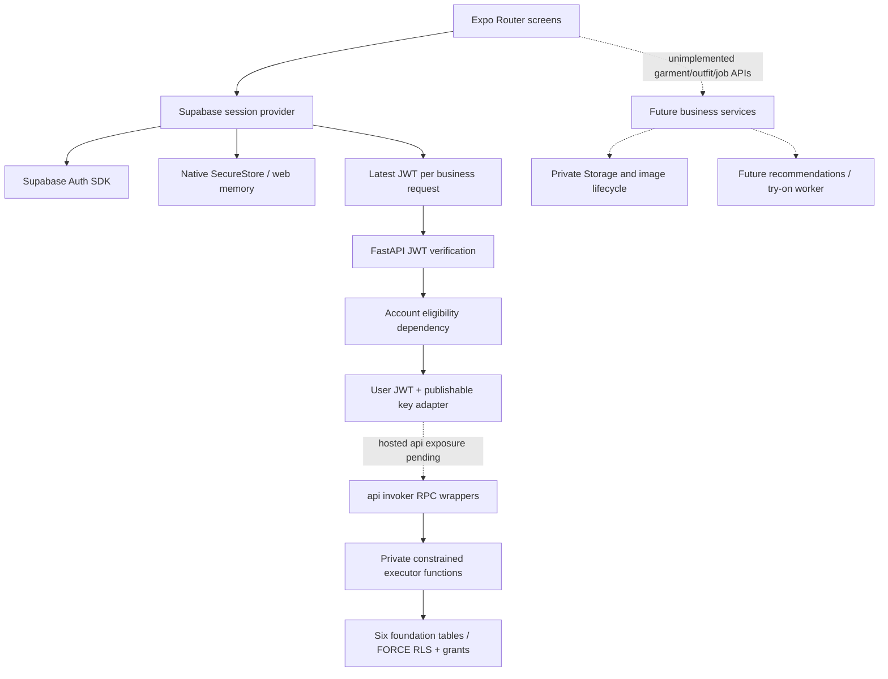

# Drape & Drop — Project Completion Audit

Audit timestamp: **2026-11-08T18:09:32+05:30**, Asia/Kolkata (UTC+05:30). Repository: `/Users/nanni/ReactLeran/DrapeDrop`. This is an evidence snapshot of the current feature checkout **including existing uncommitted Auth work**; it is not a release certification.

Status legend: `[x]` verified complete within the stated boundary; `[~]` implemented awaiting integration/device/hosted verification; `[ ]` absent; `[!]` blocker/error; `[?]` unresolved decision; `[N/A]` not applicable. “Local” never means hosted security accepted. Proposed schema attributes are explicitly marked as proposals.

## 1. Executive summary

The project has a substantial Expo frontend, an uncommitted Supabase email/password Auth integration, and a locally tested FastAPI/database security foundation. It does **not** have completed application backend workflows, a deployed application schema, verified hosted end-to-end workflows, or an Android release build.

- **31 requested workflow buckets: 1 verified complete (public introduction/navigation), 30 partially implemented, 0 wholly absent buckets.** A partial bucket can contain missing actions; this count must not be read as 30 working product workflows. Try-on status UI exists, but history is absent. Google sign-in and live password change are absent within the partially implemented Auth/settings buckets.
- **0 business workflows verified end-to-end against real Auth + FastAPI + hosted database/Storage; 0 production-ready workflow claims.**
- **35 documented API contracts audited; 4 FastAPI operations exist** across two paths: GET/PATCH `/profile` and GET/PATCH `/settings`. They are intentionally fail-closed while the foundation flag is false. The other 31 contracts have no FastAPI route; some legacy Auth responsibilities now use Supabase SDK rather than FastAPI.
- **15 proposed application tables; 6 implemented in one local migration; 9 proposed tables absent.** Auth identity is external and not counted as an application table. No hosted application schema was observed.
- Actual tests: **19 frontend + 47 backend + 35 PostgreSQL tests passed**; additionally **12 disposable-database constraint checks passed**. The broad pytest invocation initially skipped 35 database cases; the dedicated runner then executed all 35 successfully. Hosted/native acceptance remains unavailable, not passed.
- Git: **3 local branches, 4 remote branches, 10 local annotated tags; 8 tags currently advertised remotely.** Local HEAD is two commits ahead of its remote feature branch. Auth work is not committed or tagged. Main lacks the mobile/backend/database work.
- **12 milestone blockers** are enumerated once in Section 23. No migration application, remote settings change, feature-flag change, source fix, Git commit, tag or push was performed in this audit.

The most useful next milestone is a reviewed checkpoint of the Auth working tree, then separately approved hosted foundation integration verification. Implementing AI or more business tables before those acceptance gates would multiply integration uncertainty.

## 2. Confirmed technology stack

| Layer | Actual evidence/version | State |
|---|---|---|
| Mobile | React Native 0.88.1; React/React DOM 19.3.0; Expo ~58.0.23; Router ~58.0.30; TypeScript ~6.0.3 | [x] package files and successful exports |
| Frontend support | Supabase JS ^2.119.0; SecureStore ~58.0.2; Crypto ~58.0.7; ImagePicker ~58.0.10; URL polyfill ^4.0.0; RN Web ^0.21.4 | [~] native behavior pending |
| Toolchain | Repository Node 24; actual laptop Node v25.9.0; ESLint 9.39.5; Python local venv 3.13 / project >=3.12 | [!] supported Node baseline not exercised here |
| API | FastAPI 0.162.0; Uvicorn 0.54.0; Pydantic 2.14.3; settings 2.16.2; httpx 0.28.1; PyJWT 2.15.1; cryptography 50.0.2 | [x] lockfile / local tests |
| Database | Supabase PostgreSQL approved; disposable local PostgreSQL 15.18; hosted dashboard 17.11.0.018; CLI 3.0.0 | [~] local SQL proof, managed PG17 verification pending |
| Hosted Auth / Data API | Dashboard Auth 2.197.0; PostgREST 14.18; email enabled and confirmation on | [~] configuration observed, no real-account acceptance |
| Storage | Supabase Storage approved; only restrictive lifecycle SQL policy implemented locally | [ ] buckets and positive ownership policies absent remotely |
| Workers / ML | ml/README.md empty; no worker, queue, model or provider implementation | [ ] planned |
| Legacy | Main contains older Vite/web project; original PRD/architecture mention Next/Node; current checkout is Expo/FastAPI | [N/A] historical plans are not current runtime |

Evidence: [mobile/package.json](/Users/nanni/ReactLeran/DrapeDrop/mobile/package.json), [mobile/package-lock.json](/Users/nanni/ReactLeran/DrapeDrop/mobile/package-lock.json), [mobile/.nvmrc](/Users/nanni/ReactLeran/DrapeDrop/mobile/.nvmrc), [backend/requirements.lock](/Users/nanni/ReactLeran/DrapeDrop/backend/requirements.lock), [backend/pyproject.toml](/Users/nanni/ReactLeran/DrapeDrop/backend/pyproject.toml), [mobile/app.json](/Users/nanni/ReactLeran/DrapeDrop/mobile/app.json), [docs/PRD.md](/Users/nanni/ReactLeran/DrapeDrop/docs/PRD.md), [docs/architecture.md](/Users/nanni/ReactLeran/DrapeDrop/docs/architecture.md). No new dependency recommendation or external standards claim is made here.

## 3. Current architecture diagram

Solid edges describe implemented source paths, **not successful hosted integration**. Dashed edges are missing/unverified business paths.

`SessionProvider.request` obtains the current SDK token for each request. `verified_principal` derives UUID from verified `sub`. `active_user_data` binds an immutable principal to `UserDataAPI`. Profile/settings RPC helpers run as non-owner, non-bypass roles, so RLS remains effective. Feature flag false selects `UnconfiguredEligibility`, which denies access rather than falling back to elevated credentials.

## 4. Repository structure

| Path | Actual responsibility | Completion boundary |
|---|---|---|
| mobile/src/app | Expo file routes including auth-confirm, profile/body, wardrobe/catalog/outfits, recommendations, try-on, settings and admin | UI and client wiring; not full backend |
| mobile/src/features | Schemas, validation, editor/collection/recommendation screens, session provider, memory drafts | Auth migration currently uncommitted |
| mobile/src/services | Shared fetch transport plus new Supabase Auth contracts/storage/client | Legacy api/resources.ts deleted in working tree |
| mobile/tests | auth.test.mjs and workflows.test.mjs | 19 Node tests; no mounted component/device suite |
| backend/app | Config, JWT, dependencies, Data API adapter, foundation routes, error handling | Four business API operations |
| backend/tests | Security, API and real PostgreSQL tests; isolated runner/test primitives | 82 backend/database cases across separate runs |
| supabase | config.toml, one migration, verification/inspect_foundation.sql, README | Local defaults are not hosted configuration |
| docs/backend | 35-contract audit, security architecture, entity/logical/physical designs, checkpoints, setup and verification reports | Some historical statements superseded by current source |
| docs/versions and VERSIONS.md | Frontend preview/checkpoint history | Not production release evidence |
| .github/workflows | Mobile checks and backend checks | Definitions exist; remote run results not inspected |
| ml, docker, scripts | ml/README.md, docker/docker-compose.yml and scripts/setup.sh are empty | No executable ML, deployment stack or setup script |
| frontend on main | Older web implementation removed by feature branch | Not the Expo current product |

Inspected source families include every current screen route, shared component, schema/serializer, session/auth module, transport/resource/draft hook; all backend app/test files; all migration/verification SQL; package/lock/app/environment templates; Git refs/history/diffs; database design/setup/checkpoint docs and original PRD. Ignored environment files were checked privately for key presence/configuration shape only; their values are not included. No credential store was dumped.

## 5. Git branch inventory

Read-only `git ls-remote --heads --tags origin` succeeded during this audit; the four live remote branch heads agree with the cached refs. `origin/HEAD` is a symbolic alias and is not counted as a fifth branch. Distances are **main-only / ref-only** from `git rev-list --left-right --count main...REF`.

| Branch/tag | Type | Commit SHA | Contains implementation | Reachable from main | Status |
|---|---|---|---|---|---|
| refs/heads/feature/backend-security-foundation | local branch | 74636c2932a2f55c94fc1f399e72cc670b736418 | chore(supabase): checkpoint CLI link with migration history pending | No | [x] inspected; distance 0/9; current, unmerged |
| refs/heads/feature/mobile-foundation | local branch | d61b7808ba3873c99465a07b22da66f45fe5a05c | feat(frontend): retain drafts and version verification checkpoint | No | [x] inspected; distance 0/4 |
| refs/heads/main | local branch | e70b2f9c6e33a455d04e8aa4b6a1dd9b44c80b3d | Delete FRONTEND_OVERHAUL_SUMMARY.md | Yes | [x] inspected; distance 0/0 |
| refs/remotes/origin/feature/backend-security-foundation | remote branch (cached) | bb46044315e6102ab12444bdd56aaf2af37730f9 | feat(preview): clarify status and group workflow navigation | No | [x] inspected; distance 0/7 |
| refs/remotes/origin/feature/mobile-foundation | remote branch (cached) | d61b7808ba3873c99465a07b22da66f45fe5a05c | feat(frontend): retain drafts and version verification checkpoint | No | [x] inspected; distance 0/4 |
| refs/remotes/origin/frontend/workflow-0-foundations | remote branch (cached) | 3185c50e74c5d0e67968ab38854504a04291779a | feat(frontend): add wardrobe CRUD filtering and garment components | No | [x] inspected; distance 0/4 |
| refs/remotes/origin/main | remote branch (cached) | e70b2f9c6e33a455d04e8aa4b6a1dd9b44c80b3d | Delete FRONTEND_OVERHAUL_SUMMARY.md | Yes | [x] inspected; distance 0/0 |

Main is an ancestor of current HEAD. `git log HEAD..main` is empty; nine commits exist in HEAD but not main. Both local feature branches are unmerged into main. Current feature HEAD is two commits ahead of live `origin/feature/backend-security-foundation`; the database-foundation and CLI checkpoints have not been advertised on the remote. No branch checkout/fetch/ref update was needed.

## 6. Git tag inventory

All ten local tags are **annotated** (`git cat-file -t` = tag). SHA below is the peeled commit, not the annotation object. The live remote advertises eight annotated tags; the two backend-v0.2.0 tags exist locally only. None of these tag commits is reachable from current main.

| Branch/tag | Type | Commit SHA | Contains implementation | Reachable from main | Status |
|---|---|---|---|---|---|
| refs/tags/backend-v0.1.0-security-foundation-preview | Annotated tag | fd0f3dc50a959b27a4cd68ff899ad513e449f11e | feat(backend): add fail-closed JWT and user-scoped access foundation | No | [x] local + remote advertised |
| refs/tags/backend-v0.2.0-cli-linked-history-pending | Annotated tag | 74636c2932a2f55c94fc1f399e72cc670b736418 | chore(supabase): checkpoint CLI link with migration history pending | No | [~] local only |
| refs/tags/backend-v0.2.0-database-foundation | Annotated tag | 4d3d87c60499c068bc7f6ec4592e99e23ec220ba | feat(backend): checkpoint approved v0.2.0 database foundation | No | [~] local only |
| refs/tags/database-v0.1.0-entity-inventory | Annotated tag | 3c790de8a952b639087e26305e8c9774a4d4056f | docs(database): inventory entities relationships and API coverage | No | [x] local + remote advertised |
| refs/tags/v0.0.1-frontend-foundations-preview | Annotated tag | 9977481d26e612deff32bbcab1f40321a73ef178 | feat(frontend): introduce editorial studio foundations preview | No | [x] local + remote advertised |
| refs/tags/v0.1.0-frontend-auth-preview | Annotated tag | c9febb57e5177337658d88fc29f12c134f52c550 | feat(frontend): add persistent demo accounts onboarding and profile | No | [x] local + remote advertised |
| refs/tags/v0.2.0-frontend-photos-preview | Annotated tag | 52af9b0fa593e3ba03639036fb3da323171c8b4e | feat(frontend): implement persistent personal photo workflow | No | [x] local + remote advertised |
| refs/tags/v0.3.0-frontend-wardrobe-preview | Annotated tag | 3185c50e74c5d0e67968ab38854504a04291779a | feat(frontend): add wardrobe CRUD filtering and garment components | No | [x] local + remote advertised |
| refs/tags/v0.4.0-frontend-verification-preview | Annotated tag | d61b7808ba3873c99465a07b22da66f45fe5a05c | feat(frontend): retain drafts and version verification checkpoint | No | [x] local + remote advertised |
| refs/tags/v0.4.1-workflow-preview | Annotated tag | bb46044315e6102ab12444bdd56aaf2af37730f9 | feat(preview): clarify status and group workflow navigation | No | [x] local + remote advertised |

Checkpoint interpretation:

- Latest frontend **reviewable preview**, not stable production: `v0.4.1-workflow-preview` → `bb46044315e6102ab12444bdd56aaf2af37730f9`.
- Latest backend checkpoint: `backend-v0.2.0-cli-linked-history-pending` → current HEAD `74636c2932a2f55c94fc1f399e72cc670b736418`.
- Latest database foundation: `backend-v0.2.0-database-foundation` → `4d3d87c60499c068bc7f6ec4592e99e23ec220ba`.
- Latest frontend Auth: current working tree; **no commit/tag contains the complete new Auth implementation**. Older auth-preview tag describes a superseded demo implementation and must not be interpreted as the current Supabase SDK milestone.

Recommend a new clearly named Auth integration preview tag only after review, commit and defined acceptance checks; a hosted-verified foundation tag only after actual hosted security acceptance. No tag is created or moved here.

## 7. Main branch completeness

`main` and live/cached `origin/main` both point to `e70b2f9c6e33a455d04e8aa4b6a1dd9b44c80b3d` (“Delete FRONTEND_OVERHAUL_SUMMARY.md”). Main has the legacy web frontend and placeholder backend, not the current Expo app, FastAPI security implementation, migration, current backend design/verification docs or current CI definitions. No current mobile release can be reconstructed from main alone.

Recommend reviewing/merging the cumulative feature branch after preserving the Auth working tree in a separate reviewed commit. Do not blindly merge the older mobile branch again: current feature history already includes it. Inspect old `frontend/workflow-0-foundations` content for historical value; it is not proof that its changes are missing from the newer rewritten app. Release gates belong after merge and integration validation, not merely after a tag exists.

## 8. Commit and uncommitted work inventory

| Commit on current branch, absent main | Subject |
|---|---|
| 74636c2932a2f55c94fc1f399e72cc670b736418 | chore(supabase): checkpoint CLI link with migration history pending |
| 4d3d87c60499c068bc7f6ec4592e99e23ec220ba | feat(backend): checkpoint approved v0.2.0 database foundation |
| bb46044315e6102ab12444bdd56aaf2af37730f9 | feat(preview): clarify status and group workflow navigation |
| 3c790de8a952b639087e26305e8c9774a4d4056f | docs(database): inventory entities relationships and API coverage |
| fd0f3dc50a959b27a4cd68ff899ad513e449f11e | feat(backend): add fail-closed JWT and user-scoped access foundation |
| d61b7808ba3873c99465a07b22da66f45fe5a05c | feat(frontend): retain drafts and version verification checkpoint |
| 8b89d0fdc7e079e68b1c73a05e2d4eee7dbdc6c7 | feat(mobile): implement API-driven frontend workflow screens |
| 6f1768f9906c70876c2d4da0ce041baebcee05b2 | feat(mobile): enable browser preview and document checkpoint |
| ebaf8677c5a531a0310df0481011031902c798ae | feat(mobile): replace web frontend with Android Expo foundation |

Existing working-tree changes, captured before adding this report:

| State | Path | Interpretation |
|---|---|---|
|  M | mobile/.env.example | Existing Auth/documentation work; preserved |
|  M | mobile/app.json | Existing Auth/documentation work; preserved |
|  M | mobile/package-lock.json | Existing Auth/documentation work; preserved |
|  M | mobile/package.json | Existing Auth/documentation work; preserved |
|  M | mobile/src/app/outfits/[id].tsx | Existing Auth/documentation work; preserved |
|  M | mobile/src/app/outfits/new.tsx | Existing Auth/documentation work; preserved |
|  M | mobile/src/app/reset-password.tsx | Existing Auth/documentation work; preserved |
|  M | mobile/src/app/settings.tsx | Existing Auth/documentation work; preserved |
|  M | mobile/src/app/try-on.tsx | Existing Auth/documentation work; preserved |
|  M | mobile/src/components/Screen.tsx | Existing Auth/documentation work; preserved |
|  M | mobile/src/features/AuthScreen.tsx | Existing Auth/documentation work; preserved |
|  M | mobile/src/features/EditorScreen.tsx | Existing Auth/documentation work; preserved |
|  M | mobile/src/features/RecommendationsScreen.tsx | Existing Auth/documentation work; preserved |
|  M | mobile/src/features/session.tsx | Existing Auth/documentation work; preserved |
|  M | mobile/src/hooks/useResource.ts | Existing Auth/documentation work; preserved |
|  D | mobile/src/services/api/resources.ts | Existing Auth/documentation work; preserved |
|  M | mobile/src/types/domain.ts | Existing Auth/documentation work; preserved |
| ?? | docs/backend/frontend-supabase-auth-integration.md | Existing Auth/documentation work; preserved |
| ?? | docs/backend/supabase-remote-migration-history.md | Existing Auth/documentation work; preserved |
| ?? | mobile/src/app/auth-confirm.tsx | Existing Auth/documentation work; preserved |
| ?? | mobile/src/services/auth/contracts.ts | Existing Auth/documentation work; preserved |
| ?? | mobile/src/services/auth/storage.ts | Existing Auth/documentation work; preserved |
| ?? | mobile/src/services/auth/supabase.ts | Existing Auth/documentation work; preserved |
| ?? | mobile/tests/auth.test.mjs | Existing Auth/documentation work; preserved |

There are **17 tracked changes (16 modified, 1 deleted), 7 untracked files**, and **0 staged changes** before this audit report. The deleted legacy resources module and updates to every business caller are part of the Auth migration, not audit edits. New Auth source/tests/docs remain outside all checkpoints. Ignored `.env` files are present locally and excluded from Git; the CLI link cache is excluded. A non-secret publishable key is present in the modified mobile template; public keys can ship in clients, but environment-specific values should be reviewed before checkpointing. No secret values are reproduced here.

## 9. Frontend workflow completion matrix

Columns separate the layers. `Contract` means coverage in the preserved 35-contract inventory or explicit Supabase lifecycle design, not a newly added endpoint. `DB local` means relevant migration objects exist, not deployment or connected frontend persistence. Every row has **E2E = no and production-ready = no**, except landing where E2E business persistence is N/A; even landing has no Android production-readiness claim.

| # / Workflow | Route | UI / validation | Contract | Backend | DB local | E2E / production | Overall |
|---|---|---|---|---|---|---|---|
| 1. Landing | / | [x] static | N/A | N/A | N/A | N/A / no | [x] |
| 2. Signup | /signup | [~] implemented; details §10 | SDK / legacy 02 | Supabase SDK | Auth external | No / no | [~] |
| 3. Email confirmation | /auth-confirm | [~] implemented; details §10 | Auth lifecycle | Supabase SDK | Auth external | No / no | [~] |
| 4. Login | /login | [~] implemented; details §10 | SDK / legacy 01 | Supabase SDK | Auth external | No / no | [~] |
| 5. Logout | /settings | [~] implemented; details §10 | SDK / legacy 06 | Supabase SDK | Auth external | No / no | [~] |
| 6. Session restoration | SessionProvider | [~] implemented; details §10 | Auth lifecycle | Supabase SDK | Native adapter | No / no | [~] |
| 7. Token refresh | SessionProvider | [~] implemented; details §10 | Auth lifecycle | Supabase SDK | Native adapter | No / no | [~] |
| 8. Forgot password | /forgot-password | [~] implemented; details §10 | SDK / legacy 03 | Supabase SDK | Auth external | No / no | [~] |
| 9. Password reset | /reset-password | [~] implemented; details §10 | SDK / legacy 04 | Supabase SDK | Auth external | No / no | [~] |
| 10. Callback / deep links | /auth-confirm; /reset-password | [~] implemented; details §10 | Auth lifecycle | Supabase SDK | Auth external | No / no | [~] |
| 11. Dashboard | /dashboard | [~] implemented; details §10 | 09 | Absent | Derived / absent | No / no | [~] |
| 12. Profile | /profile | [~] implemented; details §10 | 10–11 | 4-route foundation | user_profiles | No / no | [~] |
| 13. Body / measurements | /profile/body | [~] implemented; details §10 | 12–13 | Absent | body_profiles | No / no | [~] |
| 14. Wardrobe | /wardrobe | [~] implemented; details §10 | 16 / 21 | Absent | Absent | No / no | [~] |
| 15. Add garment | /wardrobe/add | [~] implemented; details §10 | 20 | Absent | Absent | No / no | [~] |
| 16. Edit garment | /wardrobe/[id] | [~] implemented; details §10 | 21–22 | Absent | Absent | No / no | [~] |
| 17. Delete garment | /wardrobe/[id] | [~] implemented; details §10 | 23 | Absent | Absent | No / no | [~] |
| 18. Garment image upload | Garment editors | [~] implemented; details §10 | 20 / 22 / 24 / 26 | Absent | Absent | No / no | [~] |
| 19. Shared catalog | /catalog | [~] implemented; details §10 | 17 | Absent | Absent | No / no | [~] |
| 20. Catalog detail | /catalog/[id] | [~] implemented; details §10 | 28 | Absent | Absent | No / no | [~] |
| 21. Saved outfits | /outfits | [~] implemented; details §10 | 18 / 30 | Absent | Absent | No / no | [~] |
| 22. Create outfit | /outfits/new | [~] implemented; details §10 | 29 A | Absent | Absent | No / no | [~] |
| 23. Edit outfit | /outfits/[id] | [~] implemented; details §10 | 30–31 | Absent | Absent | No / no | [~] |
| 24. Delete outfit | /outfits/[id] | [~] implemented; details §10 | 32 | Absent | Absent | No / no | [~] |
| 25. Recommendations | /recommendations | [~] implemented; details §10 | 33 | Absent | Absent | No / no | [~] |
| 26. Save recommendation | /recommendations | [~] implemented; details §10 | 29 B | Absent | Absent | No / no | [~] |
| 27. Virtual try-on | /try-on | [~] implemented; details §10 | 34 | Absent | Absent | No / no | [~] |
| 28. Try-on history / status | /try-on | [~] implemented; details §10 | 35 (status only) | Absent | Absent | No / no | [~] |
| 29. Settings | /settings; /preferences | [~] implemented; details §10 | 14–15 / 05 | Settings GET/PATCH only | user_preferences | No / no | [~] |
| 30. Account lifecycle | /settings + backend dependency | [~] implemented; details §10 | 08 / security design | Eligibility only | Lifecycle + tombstone | No / no | [~] |
| 31. Admin catalog | /admin; /admin/catalog/* | [~] implemented; details §10 | 19 / 24–27 | Absent | Membership only | No / no | [~] |

No feature bucket is counted as complete from a screen alone. The one complete bucket is the static landing/navigation workflow, which has no persistence contract. Missing individual actions and backend modules are counted separately in Sections 21/23 instead of inflating the number of fully missing buckets.

## 10. Attribute-by-attribute frontend audit

**Shared rules (source: `features/validation.ts`, `schema.ts`, `EditorScreen`, `CollectionScreen`, `Screen`, `useResource`, `useDraft`):** required strings reject whitespace; short text max 200 characters, multiline max 2,000; no implicit minimum for optional text. Password min 8/max 200, including login/current password; email basic pattern/max 200, trim at submission. Numeric form state is string; finite numeric submit value; optional blank numeric becomes `null`. Editor `payloadFor` trims every text field and emits all fields, using `""` for blank optional text: PATCH is a full snapshot. Outfit/recommendation forms do not all use that serializer. UI enum options do not imply runtime response validation.

Authenticated screens use `Gate`; `useResource` skips requests in preview, signed-out and unauthorized admin states; loading indicator, read error notice/manual retry, no fabricated empty data on network failure. Collections distinguish genuine empty `items` from loading/error; mutation forms keep drafts on ordinary failure. Editors require a successful record read before editing. Memory drafts survive route navigation but not process restart/page reload; identity changes/logout clear the store. Dirty-form browser unload warning exists; native Back/unsaved-exit behavior is unverified. Images use URL-only `Image` sources without Bearer headers. API errors map fixed messages, not field-level FastAPI details. 401 is an error, **not automatic logout** in the current Auth migration.

Accessibility baseline: named inputs, button/radio/checkbox roles and checked states, image labels, alert text and disabled/busy submit controls exist. No mounted component, TalkBack, font-scaling, contrast or physical-device accessibility acceptance is claimed. Shared tests cover helpers/SDK/transport, not every route rendering. Each table below describes actual inputs/outputs, not new contract requirements.

### 10.1. Landing — [x]

Route: `/`. Evidence: [mobile/src/app/index.tsx](/Users/nanni/ReactLeran/DrapeDrop/mobile/src/app/index.tsx). Static introduction and Get started navigation browser-verified.

| Attribute / action | Type / requirement | Validation / default / empty handling | API / persistence / state |
|---|---|---|---|
| Action / intro | Static content | No inputs/defaults | Get started → /login; preview link → /preview |

Browser tested landing text and actual button navigation to /login. No backend needed. Static UI verified; native release remains separate.

### 10.2. Signup — [~]

Route: `/signup`. Evidence: [mobile/src/features/AuthScreen.tsx](/Users/nanni/ReactLeran/DrapeDrop/mobile/src/features/AuthScreen.tsx). Validation + SDK; hosted email/bootstrapping pending.

| Attribute / action | Type / requirement | Validation / default / empty handling | API / persistence / state |
|---|---|---|---|
| name | Required string | Trim; 1–200 nonblank | Auth signup metadata name; no trusted role |
| email | Required email | Pattern / max200; trim | Supabase signUp |
| password | Required secret string | 8–200; unmodified | Supabase Auth only |
| confirm | Required secret string | 8–200 and equality | Local only, never sent |

States: readiness/busy, input validation and sanitized errors; callback screens reject missing/invalid link. Success paths are implemented in source/SDK tests, not hosted-tested. No suitable designated test account was used or created. On web reload, sign-in is required by design. Native relaunch/refresh/link dispatch remains pending. Unit evidence: auth.test.mjs; callback screen behavior itself is not mounted by that suite.

### 10.3. Email confirmation — [~]

Route: `/auth-confirm`. Evidence: [mobile/src/app/auth-confirm.tsx](/Users/nanni/ReactLeran/DrapeDrop/mobile/src/app/auth-confirm.tsx). token_hash callback; hosted default template incompatible.

| Attribute / action | Type / requirement | Validation / default / empty handling | API / persistence / state |
|---|---|---|---|
| token_hash | Required callback string | Exactly one 16–256 allowed ASCII hash; missing/array rejected | verifyOtp(type=email); temporary isolated client |
| confirmation action | Button | Busy guard; fresh-link error on failure | Success local signOut then /login; no resend UI |

States: readiness/busy, input validation and sanitized errors; callback screens reject missing/invalid link. Success paths are implemented in source/SDK tests, not hosted-tested. No suitable designated test account was used or created. On web reload, sign-in is required by design. Native relaunch/refresh/link dispatch remains pending. Unit evidence: auth.test.mjs; callback screen behavior itself is not mounted by that suite.

### 10.4. Login — [~]

Route: `/login`. Evidence: [mobile/src/features/AuthScreen.tsx](/Users/nanni/ReactLeran/DrapeDrop/mobile/src/features/AuthScreen.tsx). Email/password; Google unavailable.

| Attribute / action | Type / requirement | Validation / default / empty handling | API / persistence / state |
|---|---|---|---|
| email | Required email | Pattern / max200; trim | signInWithPassword |
| password | Required secret string | 8–200, not trimmed | Auth SDK; success → /dashboard |
| Google action | Button | Shows unavailable message | No OAuth operation |

States: readiness/busy, input validation and sanitized errors; callback screens reject missing/invalid link. Success paths are implemented in source/SDK tests, not hosted-tested. No suitable designated test account was used or created. On web reload, sign-in is required by design. Native relaunch/refresh/link dispatch remains pending. Unit evidence: auth.test.mjs; callback screen behavior itself is not mounted by that suite.

### 10.5. Logout — [~]

Route: `/settings`. Evidence: [mobile/src/features/session.tsx](/Users/nanni/ReactLeran/DrapeDrop/mobile/src/features/session.tsx). Local scope; server revocation failure handled, JWT can outlive logout.

| Attribute / action | Type / requirement | Validation / default / empty handling | API / persistence / state |
|---|---|---|---|
| confirmation | Local dialog state | Cancel/confirm; busy control | signOut(scope=local); clear drafts/gate immediately |
| server revocation | SDK result | Failure is not reported as confirmed revocation | Fallback storage clearing; error text; no global logout |

States: readiness/busy, input validation and sanitized errors; callback screens reject missing/invalid link. Success paths are implemented in source/SDK tests, not hosted-tested. No suitable designated test account was used or created. On web reload, sign-in is required by design. Native relaunch/refresh/link dispatch remains pending. Unit evidence: auth.test.mjs; callback screen behavior itself is not mounted by that suite.

### 10.6. Session restoration — [~]

Route: `SessionProvider`. Evidence: [mobile/src/features/session.tsx](/Users/nanni/ReactLeran/DrapeDrop/mobile/src/features/session.tsx). INITIAL_SESSION gate; web intentionally memory-only.

| Attribute / action | Type / requirement | Validation / default / empty handling | API / persistence / state |
|---|---|---|---|
| persisted session | SDK AuthSession | Native chunked SecureStore; web no persistence | INITIAL_SESSION before protected gate opens |
| identity | Auth UUID + email | Presentation role always user | Process restart/hardware restoration pending |

States: readiness/busy, input validation and sanitized errors; callback screens reject missing/invalid link. Success paths are implemented in source/SDK tests, not hosted-tested. No suitable designated test account was used or created. On web reload, sign-in is required by design. Native relaunch/refresh/link dispatch remains pending. Unit evidence: auth.test.mjs; callback screen behavior itself is not mounted by that suite.

### 10.7. Token refresh — [~]

Route: `SessionProvider`. Evidence: [mobile/src/services/auth/contracts.ts](/Users/nanni/ReactLeran/DrapeDrop/mobile/src/services/auth/contracts.ts). Foreground SDK refresh, latest JWT; hardware/live tests pending.

| Attribute / action | Type / requirement | Validation / default / empty handling | API / persistence / state |
|---|---|---|---|
| refresh token | SDK internal secret | Never request body to FastAPI | SDK refresh; foreground AppState scheduling |
| access JWT | Current session value | Expiry/subject/initiating identity checked | Latest token retrieved before every business request |

States: readiness/busy, input validation and sanitized errors; callback screens reject missing/invalid link. Success paths are implemented in source/SDK tests, not hosted-tested. No suitable designated test account was used or created. On web reload, sign-in is required by design. Native relaunch/refresh/link dispatch remains pending. Unit evidence: auth.test.mjs; callback screen behavior itself is not mounted by that suite.

### 10.8. Forgot password — [~]

Route: `/forgot-password`. Evidence: [mobile/src/features/AuthScreen.tsx](/Users/nanni/ReactLeran/DrapeDrop/mobile/src/features/AuthScreen.tsx). Enumeration-safe text; email delivery pending.

| Attribute / action | Type / requirement | Validation / default / empty handling | API / persistence / state |
|---|---|---|---|
| email | Required email | Pattern/max200; trim | resetPasswordForEmail; redirect /reset-password |
| success message | Text | Enumeration-safe; no existing-account disclosure | Clears fields; no hosted delivery test |

States: readiness/busy, input validation and sanitized errors; callback screens reject missing/invalid link. Success paths are implemented in source/SDK tests, not hosted-tested. No suitable designated test account was used or created. On web reload, sign-in is required by design. Native relaunch/refresh/link dispatch remains pending. Unit evidence: auth.test.mjs; callback screen behavior itself is not mounted by that suite.

### 10.9. Password reset — [~]

Route: `/reset-password`. Evidence: [mobile/src/app/reset-password.tsx](/Users/nanni/ReactLeran/DrapeDrop/mobile/src/app/reset-password.tsx). Isolated recovery session then updateUser.

| Attribute / action | Type / requirement | Validation / default / empty handling | API / persistence / state |
|---|---|---|---|
| token_hash | Callback string | Single valid hash required before verify | verifyOtp(type=recovery) isolated in-memory client |
| password | Required secret string | 8–200 | updateUser only after recovery verified |
| confirm | Required secret string | Equality / 8–200 | Local only; success clear and offer login |

States: readiness/busy, input validation and sanitized errors; callback screens reject missing/invalid link. Success paths are implemented in source/SDK tests, not hosted-tested. No suitable designated test account was used or created. On web reload, sign-in is required by design. Native relaunch/refresh/link dispatch remains pending. Unit evidence: auth.test.mjs; callback screen behavior itself is not mounted by that suite.

### 10.10. Callback / deep links — [~]

Route: `/auth-confirm; /reset-password`. Evidence: [mobile/src/services/auth/supabase.ts](/Users/nanni/ReactLeran/DrapeDrop/mobile/src/services/auth/supabase.ts). Custom scheme; no production verified App Links.

| Attribute / action | Type / requirement | Validation / default / empty handling | API / persistence / state |
|---|---|---|---|
| native redirect | Derived URL | drapedrop://auth-confirm or reset-password | Expo scheme configured; allowlist absent remotely |
| web redirect | Derived current origin/path | No token/session URL parameter accepted | Current routes consume token_hash, not default code/fragment flow |

States: readiness/busy, input validation and sanitized errors; callback screens reject missing/invalid link. Success paths are implemented in source/SDK tests, not hosted-tested. No suitable designated test account was used or created. On web reload, sign-in is required by design. Native relaunch/refresh/link dispatch remains pending. Unit evidence: auth.test.mjs; callback screen behavior itself is not mounted by that suite.

### 10.11. Dashboard — [~]

Route: `/dashboard`. Evidence: [mobile/src/app/dashboard.tsx](/Users/nanni/ReactLeran/DrapeDrop/mobile/src/app/dashboard.tsx). Count rendering, gates, error/retry; no backend.

| Attribute / action | Type / requirement | Validation / default / empty handling | API / persistence / state |
|---|---|---|---|
| wardrobeCount | Response number | Zero displayed; no runtime numeric schema | GET/dashboard |
| savedOutfitCount | Response number | Zero displayed | GET/dashboard |
| recommendationCount | Response number | Meaning of count unresolved | GET/dashboard |

States and transitions are source-implemented as described in the table; relevant controls disable while busy, errors remain visible and can be retried manually. No successful hosted mutation/result, device persistence or production-readiness claim. Shared helper tests do not constitute this workflow’s E2E test.

### 10.12. Profile — [~]

Route: `/profile`. Evidence: [mobile/src/app/profile/index.tsx](/Users/nanni/ReactLeran/DrapeDrop/mobile/src/app/profile/index.tsx). GET/PATCH locally tested; disabled/live bootstrap pending.

| Attribute / action | Type / requirement | Validation / default / empty handling | API / persistence / state |
|---|---|---|---|
| name | Required string | 1–200 nonblank | ProfileWrite / user_profiles.name |
| style | Optional multiline | Max2000; blank → empty API / NULL SQL | user_profiles.style |
| location | Optional string | Max200; same blank handling | user_profiles.location |
| bio | Optional multiline | Max2000; same blank handling | user_profiles.bio |

States: guarded initial read (where editing), loading/error/manual retry, draft/validation errors, busy save, success clear/refetch or collection navigation, confirm/discard dialogs where supplied. Failed writes retain draft. Preview never saves. Shared helper tests do not prove persistence. Except profile/settings, APIs are absent; every hosted persistence path is unverified.

### 10.13. Body / measurements — [~]

Route: `/profile/body`. Evidence: [mobile/src/app/profile/body.tsx](/Users/nanni/ReactLeran/DrapeDrop/mobile/src/app/profile/body.tsx). UI rules; no granted body operation/API.

| Attribute / action | Type / requirement | Validation / default / empty handling | API / persistence / state |
|---|---|---|---|
| units | Required enum | cm / in; no default | body_profiles.units nullable for incomplete bootstrap |
| height | Optional numeric | 1–300 both units; blank → null | numeric(10,4); no body API |
| chest | Optional numeric | 1–300; unit-specific bounds unresolved | body_profiles.chest |
| waist | Optional numeric | 1–300; precision/rounding unresolved | body_profiles.waist |
| hips | Optional numeric | 1–300 | body_profiles.hips |
| inseam | Optional numeric | 1–300 | body_profiles.inseam |
| bodyShape | Optional string | Max200 | body_shape; omitted in BodyProfile type |
| skinTone | Optional string | Max200 | skin_tone; omitted in BodyProfile type |
| undertone | Optional enum | Warm / Cool / Neutral / Not sure; blank allowed | SQL nullable; omitted in BodyProfile type |
| fit | Optional enum | Fitted / Regular / Relaxed / Oversized | SQL nullable; units changes do not convert values |

States: guarded initial read (where editing), loading/error/manual retry, draft/validation errors, busy save, success clear/refetch or collection navigation, confirm/discard dialogs where supplied. Failed writes retain draft. Preview never saves. Shared helper tests do not prove persistence. Except profile/settings, APIs are absent; every hosted persistence path is unverified.

### 10.14. Wardrobe — [~]

Route: `/wardrobe`. Evidence: [mobile/src/app/wardrobe/index.tsx](/Users/nanni/ReactLeran/DrapeDrop/mobile/src/app/wardrobe/index.tsx). Collection/detail wiring only.

| Attribute / action | Type / requirement | Validation / default / empty handling | API / persistence / state |
|---|---|---|---|
| search | Optional query string | Trim when Search pressed; no explicit max | /wardrobe?search= |
| category | Optional enum query | Blank all / six categories | Resets cursor |
| sort | Enum query | newest default / name | No server sorting exists |
| limit / cursor | 24 / optional opaque string | URI-encoded; page replaces list | Page<Garment> with nextCursor |
| id / imageUrl | Response strings | No runtime resource validator | Detail link and unauthenticated image URL loading |

States: loading, read error/manual retry, empty/filter reset, returned rows/detail navigation. Filter/page state is memory-only. No server filtering, sorting, authorization or URL delivery was executed. Read helpers are covered; no mounted collection or real-backend E2E test exists.

### 10.15. Add garment — [~]

Route: `/wardrobe/add`. Evidence: [mobile/src/app/wardrobe/add.tsx](/Users/nanni/ReactLeran/DrapeDrop/mobile/src/app/wardrobe/add.tsx). Multipart submit wiring, validation.

| Attribute / action | Type / requirement | Validation / default / empty handling | API / persistence / state |
|---|---|---|---|
| name / category | Required metadata strings | Name 1–200; six category values | POST/wardrobe multipart metadata |
| color / brand / size / material | Optional strings | Each max200; blank empty string | Free text, no subcategory/multi-color model |
| notes | Optional multiline | Max2000 | Metadata JSON string |
| image | Required one selected file | JPEG/PNG/WebP; reported size <=10MiB | Multipart image; no upload until submit |

States: guarded initial read (where editing), loading/error/manual retry, draft/validation errors, busy save, success clear/refetch or collection navigation, confirm/discard dialogs where supplied. Failed writes retain draft. Preview never saves. Shared helper tests do not prove persistence. Except profile/settings, APIs are absent; every hosted persistence path is unverified.

### 10.16. Edit garment — [~]

Route: `/wardrobe/[id]`. Evidence: [mobile/src/app/wardrobe/[id].tsx](/Users/nanni/ReactLeran/DrapeDrop/mobile/src/app/wardrobe/[id].tsx). Read guard, full metadata update + optional image.

| Attribute / action | Type / requirement | Validation / default / empty handling | API / persistence / state |
|---|---|---|---|
| id | Route string | Encoded; no UUID-format frontend check | GET then PATCH/wardrobe/id |
| name / category | Required metadata | Same rules as create | Full form snapshot; not sparse patch |
| color / brand / size / material / notes | Optional metadata | 200 / notes2000; explicit clearing | PATCH multipart metadata |
| replacement image | Optional file | Same picker rules; absent preserves old association | New image only if selected |

States: guarded initial read (where editing), loading/error/manual retry, draft/validation errors, busy save, success clear/refetch or collection navigation, confirm/discard dialogs where supplied. Failed writes retain draft. Preview never saves. Shared helper tests do not prove persistence. Except profile/settings, APIs are absent; every hosted persistence path is unverified.

### 10.17. Delete garment — [~]

Route: `/wardrobe/[id]`. Evidence: [mobile/src/features/EditorScreen.tsx](/Users/nanni/ReactLeran/DrapeDrop/mobile/src/features/EditorScreen.tsx). Confirmation; relationships/cleanup pending.

| Attribute / action | Type / requirement | Validation / default / empty handling | API / persistence / state |
|---|---|---|---|
| id | Loaded record identity | Requires record / confirmation; no owner input | DELETE/wardrobe/id |
| confirmation | Local dialog | Cancel leaves record; busy disables mutation | Success → /wardrobe; referenced outfit behavior unresolved |

States and transitions are source-implemented as described in the table; relevant controls disable while busy, errors remain visible and can be retried manually. No successful hosted mutation/result, device persistence or production-readiness claim. Shared helper tests do not constitute this workflow’s E2E test.

### 10.18. Garment image upload — [~]

Route: `Garment editors`. Evidence: [mobile/src/components/PhotoField.tsx](/Users/nanni/ReactLeran/DrapeDrop/mobile/src/components/PhotoField.tsx). Library picker; no native/server/image pipeline acceptance.

| Attribute / action | Type / requirement | Validation / default / empty handling | API / persistence / state |
|---|---|---|---|
| uri / File | Local file handle | One library image, quality0.85; no camera | Native uri/name/type vs web File |
| MIME | Client string | Allowlist; missing defaults image/jpeg | Untrusted server must decode bytes |
| file size | Optional client metadata | Reject >10MiB only if supplied | True bytes/server resource limits unimplemented |
| filename | Client string | Missing defaults garment.jpg | Not trusted Storage object identity |

States and transitions are source-implemented as described in the table; relevant controls disable while busy, errors remain visible and can be retried manually. No successful hosted mutation/result, device persistence or production-readiness claim. Shared helper tests do not constitute this workflow’s E2E test.

### 10.19. Shared catalog — [~]

Route: `/catalog`. Evidence: [mobile/src/app/catalog/index.tsx](/Users/nanni/ReactLeran/DrapeDrop/mobile/src/app/catalog/index.tsx). Authenticated collection.

| Attribute / action | Type / requirement | Validation / default / empty handling | API / persistence / state |
|---|---|---|---|
| search / category / sort / cursor / limit | Queries | Same collection rules; limit24 | GET/catalog → Page<Garment> |
| items | Response array | Empty notice; errors separate | Authenticated shared catalog; no anonymous product read |

States: loading, read error/manual retry, empty/filter reset, returned rows/detail navigation. Filter/page state is memory-only. No server filtering, sorting, authorization or URL delivery was executed. Read helpers are covered; no mounted collection or real-backend E2E test exists.

### 10.20. Catalog detail — [~]

Route: `/catalog/[id]`. Evidence: [mobile/src/app/catalog/[id].tsx](/Users/nanni/ReactLeran/DrapeDrop/mobile/src/app/catalog/[id].tsx). Detail + try-on source link; INR formatting.

| Attribute / action | Type / requirement | Validation / default / empty handling | API / persistence / state |
|---|---|---|---|
| id | Route string | Encoded; read error/retry | GET/catalog/id |
| name / category / color / brand / size / material / notes | Response metadata | Optional fields displayed if present | No client response schema enforcement |
| price | Optional response number | INR display; catalog editor range0–1000000 | No currency/price unit field |
| try-on link | Derived source + id | source=catalog | No copy into personal wardrobe |

States: loading, read error/manual retry, empty/filter reset, returned rows/detail navigation. Filter/page state is memory-only. No server filtering, sorting, authorization or URL delivery was executed. Read helpers are covered; no mounted collection or real-backend E2E test exists.

### 10.21. Saved outfits — [~]

Route: `/outfits`. Evidence: [mobile/src/app/outfits/index.tsx](/Users/nanni/ReactLeran/DrapeDrop/mobile/src/app/outfits/index.tsx). Collection, details and wardrobe-only links.

| Attribute / action | Type / requirement | Validation / default / empty handling | API / persistence / state |
|---|---|---|---|
| search / sort / cursor / limit | Queries | Same collection; category sent blank; limit24 | GET/outfits → Page<Outfit> |
| garmentIds | Required response array | Detail maps every ID to /wardrobe/id | Cannot express catalog source safely |
| imageUrl / description / occasion | Optional response fields | No durable local cache | Server-dependent, absent implementation |

States: loading, read error/manual retry, empty/filter reset, returned rows/detail navigation. Filter/page state is memory-only. No server filtering, sorting, authorization or URL delivery was executed. Read helpers are covered; no mounted collection or real-backend E2E test exists.

### 10.22. Create outfit — [~]

Route: `/outfits/new`. Evidence: [mobile/src/app/outfits/new.tsx](/Users/nanni/ReactLeran/DrapeDrop/mobile/src/app/outfits/new.tsx). At least two wardrobe selections.

| Attribute / action | Type / requirement | Validation / default / empty handling | API / persistence / state |
|---|---|---|---|
| name | Required string | 1–200 nonblank | Raw form string in POST/outfits |
| occasion | Optional string | Max200 free text; can be absent | Not the recommendation occasion enum |
| description | Optional multiline | Max2000; can be absent | Raw form string, not payloadFor trim |
| garmentIds | Selected distinct string[] | Minimum two wardrobe IDs, no maximum defined | Aggregate validation; server ownership checks absent |

States and transitions are source-implemented as described in the table; relevant controls disable while busy, errors remain visible and can be retried manually. No successful hosted mutation/result, device persistence or production-readiness claim. Shared helper tests do not constitute this workflow’s E2E test.

### 10.23. Edit outfit — [~]

Route: `/outfits/[id]`. Evidence: [mobile/src/app/outfits/[id].tsx](/Users/nanni/ReactLeran/DrapeDrop/mobile/src/app/outfits/[id].tsx). Metadata only; no item replacement.

| Attribute / action | Type / requirement | Validation / default / empty handling | API / persistence / state |
|---|---|---|---|
| id | Route string | Read before edit | GET/PATCH/outfits/id |
| name | Required string | 1–200; raw value | Metadata PATCH |
| occasion / description | Optional strings | 200 / 2000; blank clearing | No garment membership edit action |

States: guarded initial read (where editing), loading/error/manual retry, draft/validation errors, busy save, success clear/refetch or collection navigation, confirm/discard dialogs where supplied. Failed writes retain draft. Preview never saves. Shared helper tests do not prove persistence. Except profile/settings, APIs are absent; every hosted persistence path is unverified.

### 10.24. Delete outfit — [~]

Route: `/outfits/[id]`. Evidence: [mobile/src/app/outfits/[id].tsx](/Users/nanni/ReactLeran/DrapeDrop/mobile/src/app/outfits/[id].tsx). Confirmation; garments promised preserved.

| Attribute / action | Type / requirement | Validation / default / empty handling | API / persistence / state |
|---|---|---|---|
| id | Loaded outfit string | Explicit destructive dialog | DELETE/outfits/id |
| deletion result | Ignored success body | No fake local deletion | Navigate /outfits; retain wardrobe garments |

States and transitions are source-implemented as described in the table; relevant controls disable while busy, errors remain visible and can be retried manually. No successful hosted mutation/result, device persistence or production-readiness claim. Shared helper tests do not constitute this workflow’s E2E test.

### 10.25. Recommendations — [~]

Route: `/recommendations`. Evidence: [mobile/src/features/RecommendationsScreen.tsx](/Users/nanni/ReactLeran/DrapeDrop/mobile/src/features/RecommendationsScreen.tsx). Form + response rendering; no producer.

| Attribute / action | Type / requirement | Validation / default / empty handling | API / persistence / state |
|---|---|---|---|
| occasion | Required enum | Everyday / Work / Evening / Weekend / Special occasion | POST/recommendations |
| preferences | Optional multiline | Max2000; defaults empty; raw value | No body snapshot input |
| wardrobeOnly | Required selection → boolean | My wardrobe only / Wardrobe and catalog | Server must enforce source restriction |
| items / nextCursor | Page<Outfit> response | Only items consumed; empty valid; nextCursor ignored | No scores or explanation schema |

States and transitions are source-implemented as described in the table; relevant controls disable while busy, errors remain visible and can be retried manually. No successful hosted mutation/result, device persistence or production-readiness claim. Shared helper tests do not constitute this workflow’s E2E test.

### 10.26. Save recommendation — [~]

Route: `/recommendations`. Evidence: [mobile/src/features/RecommendationsScreen.tsx](/Users/nanni/ReactLeran/DrapeDrop/mobile/src/features/RecommendationsScreen.tsx). Opaque returned ID; expiry/idempotency unresolved.

| Attribute / action | Type / requirement | Validation / default / empty handling | API / persistence / state |
|---|---|---|---|
| recommendationId | Returned outfit/result id | No client-generated content on save | POST/outfits variant B |
| saved / saving | Local arrays and busy ID | Prevents repeated click only on this screen | No durable duplicate-save guarantee; expiry unresolved |

States and transitions are source-implemented as described in the table; relevant controls disable while busy, errors remain visible and can be retried manually. No successful hosted mutation/result, device persistence or production-readiness claim. Shared helper tests do not constitute this workflow’s E2E test.

### 10.27. Virtual try-on — [~]

Route: `/try-on`. Evidence: [mobile/src/app/try-on.tsx](/Users/nanni/ReactLeran/DrapeDrop/mobile/src/app/try-on.tsx). Photo + target + consent, no processing.

| Attribute / action | Type / requirement | Validation / default / empty handling | API / persistence / state |
|---|---|---|---|
| person | Required one image | Picker rules; no permanent profile photo inferred | Multipart person |
| garmentId | Required selected id | Existing wardrobe or catalog detail | Cross-user authorization required on server |
| source | Required enum | wardrobe / catalog | Distinguishes two target domains |
| photoConsent | Required local checkbox | Resets when photo changes; multipart string true | No policy version/timestamp supplied |
| job | Response TryOnJob | Queued/processing/completed/failed | No worker or upload backend |

States and transitions are source-implemented as described in the table; relevant controls disable while busy, errors remain visible and can be retried manually. No successful hosted mutation/result, device persistence or production-readiness claim. Shared helper tests do not constitute this workflow’s E2E test.

### 10.28. Try-on history / status — [~]

Route: `/try-on`. Evidence: [mobile/src/app/try-on.tsx](/Users/nanni/ReactLeran/DrapeDrop/mobile/src/app/try-on.tsx). Manual status UI exists; history/relaunch recovery absent.

| Attribute / action | Type / requirement | Validation / default / empty handling | API / persistence / state |
|---|---|---|---|
| job.id | Screen-local response id | Not persisted across reload/relaunch | Manual GET/try-on/id |
| status | Response enum | queued / processing / completed / failed | Manual refresh; no history list route/API |
| imageUrl | Optional response URL | Completed without URL shows error | Private URL expiry/revocation unresolved |
| error | Optional response string | Shown on failed state; backend must sanitize | No provider trace/secret contract |

States and transitions are source-implemented as described in the table; relevant controls disable while busy, errors remain visible and can be retried manually. No successful hosted mutation/result, device persistence or production-readiness claim. Shared helper tests do not constitute this workflow’s E2E test.

### 10.29. Settings — [~]

Route: `/settings; /preferences`. Evidence: [mobile/src/app/settings.tsx](/Users/nanni/ReactLeran/DrapeDrop/mobile/src/app/settings.tsx). Preferences implemented locally; live password-change action absent.

| Attribute / action | Type / requirement | Validation / default / empty handling | API / persistence / state |
|---|---|---|---|
| units | Optional enum | cm / in / empty; no default | GET/PATCH/settings → nullable SQL units |
| emailNotifications | Optional enum string | Enabled / Disabled / empty | SQL bool true / false / null mapping |
| theme | Domain type only | No supported form or payload | No DB column justified |
| currentPassword / newPassword / confirmPassword | Preview-only secret fields | 8–200; match, new differs | Live uses recovery link; API05 absent |

States: guarded initial read (where editing), loading/error/manual retry, draft/validation errors, busy save, success clear/refetch or collection navigation, confirm/discard dialogs where supplied. Failed writes retain draft. Preview never saves. Shared helper tests do not prove persistence. Except profile/settings, APIs are absent; every hosted persistence path is unverified.

### 10.30. Account lifecycle — [~]

Route: `/settings + backend dependency`. Evidence: [backend/app/dependencies.py](/Users/nanni/ReactLeran/DrapeDrop/backend/app/dependencies.py). Disable/delete local SQL controls; DELETE/account and purge absent.

| Attribute / action | Type / requirement | Validation / default / empty handling | API / persistence / state |
|---|---|---|---|
| confirmation | User text | Exact DELETE enables button; extra dialog | DELETE/account {confirmation:DELETE} |
| state | Trusted system enum | active / disabled / deleting; never editable | Lifecycle SQL and eligibility only |
| tombstone | Trusted deletion evidence | Survives Auth deletion; no retention selected | No complete purge/Auth removal orchestration |

States and transitions are source-implemented as described in the table; relevant controls disable while busy, errors remain visible and can be retried manually. No successful hosted mutation/result, device persistence or production-readiness claim. Shared helper tests do not constitute this workflow’s E2E test.

### 10.31. Admin catalog — [~]

Route: `/admin; /admin/catalog/*`. Evidence: [mobile/src/app/admin/index.tsx](/Users/nanni/ReactLeran/DrapeDrop/mobile/src/app/admin/index.tsx). Live UI deliberately closed until trusted role projection.

| Attribute / action | Type / requirement | Validation / default / empty handling | API / persistence / state |
|---|---|---|---|
| role / permission | Trusted authorization | Client currently role=user; metadata ignored | catalog_manage membership local only |
| name / category | Required catalog metadata | Same garment rules | POST/PATCH/admin/catalog |
| color / brand / size / material / notes | Optional metadata | 200 / notes2000 | Same single catalog, not separate admin table |
| price | Optional number | 0–1000000 INR; blank null; rounding undecided | Proposed price_inr numeric(9,2) |
| image / id / filters | File / route / query | Same picker, editor and collection rules | All admin business routes absent |

States: guarded initial read (where editing), loading/error/manual retry, draft/validation errors, busy save, success clear/refetch or collection navigation, confirm/discard dialogs where supplied. Failed writes retain draft. Preview never saves. Shared helper tests do not prove persistence. Except profile/settings, APIs are absent; every hosted persistence path is unverified.

## 11. Complete 35 API contract audit

Contract evidence: `docs/backend/api-requirements.md` API01–35, unchanged. Source truth takes precedence for current callers. **All 35 documented: yes.** `Foundation` below means existing FastAPI Pydantic + verified-JWT + active-account dependency + local PostgreSQL RPC; flag remains false. `Absent` means no FastAPI validation/auth/authorization/persistence/test for that route. Supabase SDK tests are not tests of nonexistent FastAPI Auth routes.

| API ID | Method | Endpoint | Contract | FastAPI route | Validation | Authentication | Authorization | Database persistence | Tests | Status |
|---|---|---|---|---|---|---|---|---|---|---|
| 01 | POST | /auth/login | Yes | No | Absent in FastAPI | SDK lifecycle | Not implemented | External Auth only; not FastAPI | SDK only | [~] superseded caller; preserved legacy contract |
| 02 | POST | /auth/signup | Yes | No | Absent in FastAPI | SDK lifecycle | Not implemented | External Auth only; not FastAPI | SDK only | [~] superseded caller; preserved legacy contract |
| 03 | POST | /auth/password-reset | Yes | No | Absent in FastAPI | SDK lifecycle | Not implemented | External Auth only; not FastAPI | SDK only | [~] superseded caller; preserved legacy contract |
| 04 | POST | /auth/password-reset/confirm | Yes | No | Absent in FastAPI | SDK lifecycle | Not implemented | External Auth only; not FastAPI | SDK only | [~] superseded caller; preserved legacy contract |
| 05 | POST | /auth/password | Yes | No | Absent in FastAPI | Required by contract; absent | Not implemented | Absent | None for route | [ ] missing |
| 06 | POST | /auth/logout | Yes | No | Absent in FastAPI | SDK lifecycle | Not implemented | External Auth only; not FastAPI | SDK only | [~] superseded caller; preserved legacy contract |
| 07 | GET | /auth/me | Yes | No | Absent in FastAPI | SDK lifecycle | Not implemented | External Auth only; not FastAPI | SDK only | [~] superseded caller; preserved legacy contract |
| 08 | DELETE | /account | Yes | No | Absent in FastAPI | Required by contract; absent | Not implemented | Absent | None for route | [ ] missing |
| 09 | GET | /dashboard | Yes | No | Absent in FastAPI | Required by contract; absent | Not implemented | Absent | None for route | [ ] missing |
| 10 | GET | /profile | Yes | Yes | ProfileRead/Write; nonblank name | Verified JWT + active eligibility | Verified subject / RLS / lock | Local user_profiles RPC | API + SQL local | [~] locally tested, disabled/hosted pending |
| 11 | PATCH | /profile | Yes | Yes | ProfileRead/Write; nonblank name | Verified JWT + active eligibility | Verified subject / RLS / lock | Local user_profiles RPC | API + SQL local | [~] locally tested, disabled/hosted pending |
| 12 | GET | /profile/body | Yes | No | Absent in FastAPI | Required by contract; absent | Not implemented | Absent | None for route | [ ] missing |
| 13 | PATCH | /profile/body | Yes | No | Absent in FastAPI | Required by contract; absent | Not implemented | Absent | None for route | [ ] missing |
| 14 | GET | /settings | Yes | Yes | Preferences enum + extra=forbid | Verified JWT + active eligibility | Verified subject / RLS / lock | Local user_preferences RPC | API + SQL local | [~] locally tested, disabled/hosted pending |
| 15 | PATCH | /settings | Yes | Yes | Preferences enum + extra=forbid | Verified JWT + active eligibility | Verified subject / RLS / lock | Local user_preferences RPC | API + SQL local | [~] locally tested, disabled/hosted pending |
| 16 | GET | /wardrobe | Yes | No | Absent in FastAPI | Required by contract; absent | Not implemented | Absent | None for route | [ ] missing |
| 17 | GET | /catalog | Yes | No | Absent in FastAPI | Required by contract; absent | Not implemented | Absent | None for route | [ ] missing |
| 18 | GET | /outfits | Yes | No | Absent in FastAPI | Required by contract; absent | Not implemented | Absent | None for route | [ ] missing |
| 19 | GET | /admin/catalog | Yes | No | Absent in FastAPI | Required by contract; absent | Not implemented | Absent | None for route | [ ] missing |
| 20 | POST | /wardrobe | Yes | No | Absent in FastAPI | Required by contract; absent | Not implemented | Absent | None for route | [ ] missing |
| 21 | GET | /wardrobe/{id} | Yes | No | Absent in FastAPI | Required by contract; absent | Not implemented | Absent | None for route | [ ] missing |
| 22 | PATCH | /wardrobe/{id} | Yes | No | Absent in FastAPI | Required by contract; absent | Not implemented | Absent | None for route | [ ] missing |
| 23 | DELETE | /wardrobe/{id} | Yes | No | Absent in FastAPI | Required by contract; absent | Not implemented | Absent | None for route | [ ] missing |
| 24 | POST | /admin/catalog | Yes | No | Absent in FastAPI | Required by contract; absent | Not implemented | Absent | None for route | [ ] missing |
| 25 | GET | /admin/catalog/{id} | Yes | No | Absent in FastAPI | Required by contract; absent | Not implemented | Absent | None for route | [ ] missing |
| 26 | PATCH | /admin/catalog/{id} | Yes | No | Absent in FastAPI | Required by contract; absent | Not implemented | Absent | None for route | [ ] missing |
| 27 | DELETE | /admin/catalog/{id} | Yes | No | Absent in FastAPI | Required by contract; absent | Not implemented | Absent | None for route | [ ] missing |
| 28 | GET | /catalog/{id} | Yes | No | Absent in FastAPI | Required by contract; absent | Not implemented | Absent | None for route | [ ] missing |
| 29 | POST | /outfits | Yes | No | Absent in FastAPI | Required by contract; absent | Not implemented | Absent | None for route | [ ] missing |
| 30 | GET | /outfits/{id} | Yes | No | Absent in FastAPI | Required by contract; absent | Not implemented | Absent | None for route | [ ] missing |
| 31 | PATCH | /outfits/{id} | Yes | No | Absent in FastAPI | Required by contract; absent | Not implemented | Absent | None for route | [ ] missing |
| 32 | DELETE | /outfits/{id} | Yes | No | Absent in FastAPI | Required by contract; absent | Not implemented | Absent | None for route | [ ] missing |
| 33 | POST | /recommendations | Yes | No | Absent in FastAPI | Required by contract; absent | Not implemented | Absent | None for route | [ ] missing |
| 34 | POST | /try-on | Yes | No | Absent in FastAPI | Required by contract; absent | Not implemented | Absent | None for route | [ ] missing |
| 35 | GET | /try-on/{id} | Yes | No | Absent in FastAPI | Required by contract; absent | Not implemented | Absent | None for route | [ ] missing |

Request/response audit per contract (descriptions are inventory references, not altered contracts):

| ID / endpoint | Documented request / query | Documented response / actual mismatch |
|---|---|---|
| 01 POST /auth/login | JSON { email: string, password: string }; email trimmed; password unmodified; no query. | Session. Login requires truthy accessToken, user.id and role user/admin; navigates to dashboard. |
| 02 POST /auth/signup | JSON { name: string, email: string, password: string }; name/email trimmed; confirm password never sent. | Declared { message: string }; body ignored by UI, which displays fixed instructions and clears fields. |
| 03 POST /auth/password-reset | JSON { email: string }; trimmed. | Declared { message: string }; ignored; fixed enumeration-safe success text. |
| 04 POST /auth/password-reset/confirm | JSON { token: string, password: string }; token read from /reset-password?token=...; matching confirmation stays local. | Ignored success body; shows success, clears passwords, offers sign-in. |
| 05 POST /auth/password | JSON { currentPassword: string, newPassword: string }; confirmation local; new must differ locally. | Ignored success body; UI keeps existing session and says to sign in on next session. |
| 06 POST /auth/logout | No body/query. | Ignored success body (typed void); local session/drafts cleared in finally even on failure. |
| 07 GET /auth/me | No body/query. | User. |
| 08 DELETE /account | JSON { confirmation: "DELETE" }; UI typed confirmation and modal; no userId. | Ignored success body; success expires local session and navigates to introduction. |
| 09 GET /dashboard | No body/query. | Dashboard; actual counts including real zero values. |
| 10 GET /profile | No body/query. | Profile; flat object, no data wrapper. New-account default/empty-object behavior must be settled; 204 hides these editors. |
| 11 PATCH /profile | JSON Profile write field set; all schema keys included; blank text "", blank numbers null. | Ignored success body; then GET refetch (no returned resource merge). |
| 12 GET /profile/body | No body/query. | Body editor read shape; flat object, no data wrapper. New-account default/empty-object behavior must be settled; 204 hides these editors. |
| 13 PATCH /profile/body | JSON Body write field set; all schema keys included; blank text "", blank numbers null. | Ignored success body; then GET refetch (no returned resource merge). |
| 14 GET /settings | No body/query. | Preferences editor read shape; flat object, no data wrapper. New-account default/empty-object behavior must be settled; 204 hides these editors. |
| 15 PATCH /settings | JSON Preferences write field set; all schema keys included; blank text "", blank numbers null. | Ignored success body; then GET refetch (no returned resource merge). |
| 16 GET /wardrobe | Query: search string (including empty), category string (empty means all), sort newest / name, limit=24, optional cursor; no body. Cursor is opaque to client; server must accept omitted/empty filter values. Outfits also sends category="" despite no category control. | Page<Garment>. Next page replaces list; first-page action clears cursor. |
| 17 GET /catalog | Query: search string (including empty), category string (empty means all), sort newest / name, limit=24, optional cursor; no body. Cursor is opaque to client; server must accept omitted/empty filter values. Outfits also sends category="" despite no category control. | Page<Garment>. Next page replaces list; first-page action clears cursor. |
| 18 GET /outfits | Query: search string (including empty), category string (empty means all), sort newest / name, limit=24, optional cursor; no body. Cursor is opaque to client; server must accept omitted/empty filter values. Outfits also sends category="" despite no category control. | Page<Outfit>. Next page replaces list; first-page action clears cursor. |
| 19 GET /admin/catalog | Query: search string (including empty), category string (empty means all), sort newest / name, limit=24, optional cursor; no body. Cursor is opaque to client; server must accept omitted/empty filter values. Outfits also sends category="" despite no category control. | Page<Garment>. Next page replaces list; first-page action clears cursor. |
| 20 POST /wardrobe | multipart/form-data: metadata = JSON string of Garment metadata; image = required file. No query. | Ignored success body; navigates to collection, no returned ID consumed. |
| 21 GET /wardrobe/{id} | Path id; no body/query. | Garment (editor reads schema fields and imageUrl); no wrapper. |
| 22 PATCH /wardrobe/{id} | Path id; multipart metadata = full Garment metadata JSON string; image optional. Missing image should preserve stored image; no explicit stored-image deletion flag exists. | Ignored success body; navigates to collection. |
| 23 DELETE /wardrobe/{id} | Path id; no body/query. | Ignored success body; collection navigation. Relationship cleanup/restrictions unresolved. |
| 24 POST /admin/catalog | multipart/form-data: metadata = JSON string of Admin catalog metadata; image = required file. No query. | Ignored success body; navigates to collection, no returned ID consumed. |
| 25 GET /admin/catalog/{id} | Path id; no body/query. | Garment (editor reads schema fields and imageUrl); no wrapper. |
| 26 PATCH /admin/catalog/{id} | Path id; multipart metadata = full Admin catalog metadata JSON string; image optional. Missing image should preserve stored image; no explicit stored-image deletion flag exists. | Ignored success body; navigates to collection. |
| 27 DELETE /admin/catalog/{id} | Path id; no body/query. | Ignored success body; collection navigation. Relationship cleanup/restrictions unresolved. |
| 28 GET /catalog/{id} | Path id; no body/query. | Garment; imageUrl and optional INR price rendered directly. |
| 29 POST /outfits | JSON variant A: { name: string, garmentIds: string[], occasion?: string, description?: string }; local builder requires at least 2 selected wardrobe IDs. Variant B: { recommendationId: string }; mutually exclusive variants should be enforced. | Ignored success body; manual builder clears drafts and navigates to collection; recommendation UI marks returned recommendation ID saved. |
| 30 GET /outfits/{id} | Path id; no body/query. | Outfit; garmentIds must exist as an array (detail directly maps it). |
| 31 PATCH /outfits/{id} | JSON { name: string, occasion: string, description: string }; full local values; no garmentIds edit action. | Ignored success body; then detail GET refetch. |
| 32 DELETE /outfits/{id} | Path id; no body/query. | Ignored success body; navigate to outfits. |
| 33 POST /recommendations | JSON { occasion: "Everyday" / "Work" / "Evening" / "Weekend" / "Special occasion", preferences: string, wardrobeOnly: boolean }; preferences defaults ""; no cursor/query. | Page<Outfit>; items consumed, nextCursor ignored. No scores, explanation structure, or job ID consumed. |
| 34 POST /try-on | multipart: person=file, garmentId=string, source="wardrobe" / "catalog", photoConsent="true" (string); no JSON metadata or garment file. Consent required locally. | TryOnJob; preferably quick job acceptance (e.g. 202 JSON); frontend can display any declared status immediately. |
| 35 GET /try-on/{id} | Path id = returned job ID; no body/query. | TryOnJob. No automatic polling, websocket, history, cancellation, result-download/save request implemented. |

Confirmed mismatches and limits:

1. API01–04/06 callers now use Supabase SDK; API07 session restoration uses SDK authority, not `/auth/me`. Old custom Session/accessToken/role shape and query `token` reset flow are superseded **in current code**, while the 35-contract document remains frozen. Current `Session` contains user only; no access token in presentation context. A separately reviewed contract-lifecycle note is needed, not duplicate Auth servers.
2. API05 live current-password change is unavailable; only preview validation and a recovery link remain. API08 deletion endpoint is absent.
3. API10/11/14/15 GET responses are validated. PATCH returns 204; optional full-form fields default empty, extras forbidden. Missing/invalid upstream bodies fail closed with 503. OpenAPI does not advertise custom 401/403/503 handlers even though runtime uses them.
4. API12/13 have a local table but no route or body executor grants. API09 and all wardrobe/catalog/outfit/recommendation/try-on/admin endpoints are absent. Their test coverage cannot be inferred from transport tests.
5. API18/29/30 and API33 mixed catalog references conflict with `Outfit.garmentIds` and wardrobe-only detail navigation. No contract was silently adapted.
6. Client trusts successful JSON shapes with TypeScript casts; only implemented backend response models validate their outputs. Missing `items` or `garmentIds` could cause runtime failures on absent future APIs.
7. Collection requests send search/category/sort/limit24/cursor, with empty queries; backend cursor bounds, stable sorting/filter semantics and pagination implementations are absent. Recommendation `nextCursor` is ignored.
8. Multipart limits/413/415 validation, resource ownership/404 concealment, deletion conflicts/409 and duplicate-save idempotency are not implemented. No client business request automatic retry/replay occurs after 401.
9. All non-2xx error bodies are ignored by the frontend. 400/410/413/415/429 become generic text; current runtime API handlers expose sanitized `detail`. No common field-error envelope is agreed.

## 12. Backend implementation matrix

| Component | Actual source/symbol | Validation / concurrency / transaction evidence | State |
|---|---|---|---|
| App factory / four routes | app/main.py:create_app; app/foundation.py:router | Lifespan settings/httpx; FastAPI 0.2.0; GET/PATCH profile/settings only | [x] local source / tests |
| JWT verification | app/security.py:JWTVerifier | Asymmetric JWKS signature; expiry/iat/issuer/audience/sub/role/anonymous checks; bounded refresh/cache | [x] local cryptographic tests; [~] hosted |
| Authentication dependency | dependencies.py:verified_principal | Exactly one Bearer header; extracts verified subject; no owner header/body trust | [x] local |
| Eligibility | DatabaseEligibility / UnconfiguredEligibility | RPC userId must equal principal; false →403; invalid/unavailable →503; default feature flag false | [x] fail-closed locally |
| User-scoped Data API | data_api.py:UserDataAPI | Per-request immutable credentials; publishable apikey + current user JWT; schema api when enabled; no service fallback / redirects | [x] isolation tests; [~] hosted identity propagation |
| Profile/settings services | foundation.py:rpc / ProfileWrite / ProfileRead / Preferences | Strict string/extra validation; 204 updates; SQL transaction/locks; error code mapping | [~] not connected to hosted schema |
| Trusted lifecycle SQL | bootstrap_user / set_account_state / begin_account_deletion / set_catalog_membership | Per-subject advisory lock and row locks; idempotent bootstrap; missing/deleting deny; named operator functions | [x] local SQL tests; [ ] operational/bootstrap integration |
| Body, dashboard, garments/catalog/outfits | No router/repository implementation | No validation, aggregate transaction or source-integrity implementation | [ ] |
| Recommendation/try-on | No service/provider/worker implementation | No generation, retries, queue, timeouts, retention or idempotency implementation | [ ] |
| Uploads/Storage delivery | No upload or retrieval service | No content decoding, signed URL renewal, bucket ownership guard or cleanup | [ ] |
| Operational controls | No app CORS/rate-limit/audit-log/metrics layer | httpx timeout10; frontend timeout20; no application throttling or production observability evidence | [ ] |
| CI | backend-checks.yml | Installs lock and runs pytest + compile; no dedicated PostgreSQL runner step | [~] SQL tests skipped in normal CI unless runner explicitly added |

Normal mutations reach PostgreSQL through one RPC transaction. The account row SHARE lock serializes profile/settings mutation against disable/delete; both lock orderings are tested. Bootstrap has idempotent behavior; replaying the migration is not supported. No generic client query proxy, ORM, arbitrary SQL endpoint, service-role data path or privileged fallback exists. Adapter supports a constrained set of methods/resource paths, rather than exposing caller-controlled remote origins. Local transport cancellation/token-isolation tests do not prove cancellation of an already committed remote mutation.

## 13. Database entity and attribute matrix

**Implemented source, not hosted deployment:** six tables in `202611060001_foundation.sql`. **Proposal only:** the remaining nine tables and their attribute types below are from `physical-schema-specification.md` §3.7–3.15. For the six implemented tables, column types/nullability/defaults were compared with migration DDL; semantic validation descriptions also identify operation-level requirements and unresolved design constraints, rather than implying every phrase is a SQL CHECK. In particular, completed profile name nonblank is enforced by update operations while bootstrap can store an incomplete empty name; body updated_at currently has only its timestamp default because no body update operation exists. Entity inventory E01–E17 and logical R01–R22 remain authoritative for boundaries. This audit does not approve new columns/types.

Identity model: Supabase Auth UUID anchors user-owned singletons and future owner_id rows. Normal identity/ownership never comes from a submitted owner or role. Catalog records are shared only to active authenticated users, with trusted catalog_manage mutation authority. Administrators have no implied access to personal records. Account lifecycle/membership/deletion evidence is trusted system data.

### 13.1. user_profiles — [~] implemented locally, not hosted

| Attribute | Type | Required | Nullable | Default | Validation / authority | Owner | API mapping | Database mapping | Status |
|---|---|---|---|---|---|---|---|---|---|
| user_id | uuid | Yes | No | None; trusted explicit assignment | PK and Auth FK; Server-managed singleton identity; no user-editable UUID. | Verified Auth subject | 10–11 | app_private.user_profiles.user_id | [~] local DDL/test; no hosted table observed |
| name | varchar(200) | Yes | No | None; bootstrap explicitly supplies name or empty incomplete string | Nonblank on completed profile update; Client-editable name. Bootstrap uses verified signup name if available, otherwise explicit empty incomplete value; default behavior requires review. | Verified Auth subject | 10–11 | app_private.user_profiles.name | [~] local DDL/test; no hosted table observed |
| style | varchar(2000) | Optional | Yes | None | Length bound; Client-editable style description. | Verified Auth subject | 10–11 | app_private.user_profiles.style | [~] local DDL/test; no hosted table observed |
| location | varchar(200) | Optional | Yes | None | Length bound; Client-editable personal location; not a geolocation entity. | Verified Auth subject | 10–11 | app_private.user_profiles.location | [~] local DDL/test; no hosted table observed |
| bio | varchar(2000) | Optional | Yes | None | Length bound; Client-editable personal biography. | Verified Auth subject | 10–11 | app_private.user_profiles.bio | [~] local DDL/test; no hosted table observed |
| created_at | timestamptz | Yes | No | Database transaction time | Immutable; Server-managed creation/sort timestamp; not an API field. | Verified Auth subject | 10–11 | app_private.user_profiles.created_at | [~] local DDL/test; no hosted table observed |
| updated_at | timestamptz | Yes | No | Database transaction time | Trusted update operation advances it; Server-managed update timestamp; not an approved optimistic-lock contract. | Verified Auth subject | 10–11 | app_private.user_profiles.updated_at | [~] local DDL/test; no hosted table observed |

### 13.2. body_profiles — [~] implemented locally, not hosted

| Attribute | Type | Required | Nullable | Default | Validation / authority | Owner | API mapping | Database mapping | Status |
|---|---|---|---|---|---|---|---|---|---|
| user_id | uuid | Yes | No | None; trusted explicit assignment | PK and Auth FK; Server-managed singleton identity; no user-editable UUID. | Verified Auth subject | 12–13 (absent routes) | app_private.body_profiles.user_id | [~] local DDL/test; no hosted table observed |
| units | text | Optional | Yes | None | cm or in; required when measurements populated; Client-selected measurement meaning; conversion rules unresolved, not reinterpreted by preference changes. | Verified Auth subject | 12–13 (absent routes) | app_private.body_profiles.units | [~] local DDL/test; no hosted table observed |
| height | numeric(10,4) | Optional | Yes | None | Finite positive; current input range 1–300; Client-editable optional measurement. Unit-specific ranges/precision and conversion need review. | Verified Auth subject | 12–13 (absent routes) | app_private.body_profiles.height | [~] local DDL/test; no hosted table observed |
| chest | numeric(10,4) | Optional | Yes | None | Finite positive; current input range 1–300; Client-editable optional measurement. Unit-specific ranges/precision and conversion need review. | Verified Auth subject | 12–13 (absent routes) | app_private.body_profiles.chest | [~] local DDL/test; no hosted table observed |
| waist | numeric(10,4) | Optional | Yes | None | Finite positive; current input range 1–300; Client-editable optional measurement. Unit-specific ranges/precision and conversion need review. | Verified Auth subject | 12–13 (absent routes) | app_private.body_profiles.waist | [~] local DDL/test; no hosted table observed |
| hips | numeric(10,4) | Optional | Yes | None | Finite positive; current input range 1–300; Client-editable optional measurement. Unit-specific ranges/precision and conversion need review. | Verified Auth subject | 12–13 (absent routes) | app_private.body_profiles.hips | [~] local DDL/test; no hosted table observed |
| inseam | numeric(10,4) | Optional | Yes | None | Finite positive; current input range 1–300; Client-editable optional measurement. Unit-specific ranges/precision and conversion need review. | Verified Auth subject | 12–13 (absent routes) | app_private.body_profiles.inseam | [~] local DDL/test; no hosted table observed |
| body_shape | varchar(200) | Optional | Yes | None | Length bound; Client-editable bodyShape from form; absent from current domain type. | Verified Auth subject | 12–13 (absent routes) | app_private.body_profiles.body_shape | [~] local DDL/test; no hosted table observed |
| skin_tone | varchar(200) | Optional | Yes | None | Length bound; Client-editable skinTone description, not inferred ethnicity/biometrics. | Verified Auth subject | 12–13 (absent routes) | app_private.body_profiles.skin_tone | [~] local DDL/test; no hosted table observed |
| undertone | text | Optional | Yes | None | Warm, Cool, Neutral, Not sure; Client-editable optional selection. | Verified Auth subject | 12–13 (absent routes) | app_private.body_profiles.undertone | [~] local DDL/test; no hosted table observed |
| fit | text | Optional | Yes | None | Fitted, Regular, Relaxed, Oversized; Client-editable optional selection. | Verified Auth subject | 12–13 (absent routes) | app_private.body_profiles.fit | [~] local DDL/test; no hosted table observed |
| updated_at | timestamptz | Yes | No | Database transaction time | Trusted update operation advances it; Server-managed update timestamp; not an approved optimistic-lock contract. | Verified Auth subject | 12–13 (absent routes) | app_private.body_profiles.updated_at | [~] local DDL/test; no hosted table observed |

### 13.3. user_preferences — [~] implemented locally, not hosted

| Attribute | Type | Required | Nullable | Default | Validation / authority | Owner | API mapping | Database mapping | Status |
|---|---|---|---|---|---|---|---|---|---|
| user_id | uuid | Yes | No | None; trusted explicit assignment | PK and Auth FK; Server-managed singleton identity; no user-editable UUID. | Verified Auth subject | 14–15 | app_private.user_preferences.user_id | [~] local DDL/test; no hosted table observed |
| units | text | Optional | Yes | None | cm or in; Client-editable entry/display preference, separate from body units. | Verified Auth subject | 14–15 | app_private.user_preferences.units | [~] local DDL/test; no hosted table observed |
| email_notifications | boolean | Optional | Yes | None | Boundary maps Enabled/Disabled; Client-editable preference; NULL means unset, not silently opted in. Does not authorize a marketing system. | Verified Auth subject | 14–15 | app_private.user_preferences.email_notifications | [~] local DDL/test; no hosted table observed |
| updated_at | timestamptz | Yes | No | Database transaction time | Trusted update operation advances it; Server-managed update timestamp; not an approved optimistic-lock contract. | Verified Auth subject | 14–15 | app_private.user_preferences.updated_at | [~] local DDL/test; no hosted table observed |

### 13.4. account_lifecycle — [~] implemented locally, not hosted

| Attribute | Type | Required | Nullable | Default | Validation / authority | Owner | API mapping | Database mapping | Status |
|---|---|---|---|---|---|---|---|---|---|
| user_id | uuid | Yes | No | None; trusted explicit assignment | PK and Auth FK; Trusted immutable live subject. | Trusted system | eligibility / 08 future | app_private.account_lifecycle.user_id | [~] local DDL/test; no hosted table observed |
| state | text | Yes | No | None; trusted assignment | active, disabled or deleting; Trusted eligibility authority; no user write or role metadata fallback. | Trusted system | eligibility / 08 future | app_private.account_lifecycle.state | [~] local DDL/test; no hosted table observed |
| state_changed_at | timestamptz | Yes | No | Database transaction time | Trusted transition timestamp; Trusted control/evidence, not a public lifecycle API. | Trusted system | eligibility / 08 future | app_private.account_lifecycle.state_changed_at | [~] local DDL/test; no hosted table observed |

### 13.5. account_deletion_tombstones — [~] implemented locally, not hosted

| Attribute | Type | Required | Nullable | Default | Validation / authority | Owner | API mapping | Database mapping | Status |
|---|---|---|---|---|---|---|---|---|---|
| former_subject_id | uuid | Yes | No | Verified deletion subject | PK; deliberately NO Auth FK; Trusted minimal former identity; sensitive identifier retained only for approved security/deletion basis. | Trusted system | 08 future / trusted cleanup | app_private.account_deletion_tombstones.former_subject_id | [~] local DDL/test; no hosted table observed |
| deletion_started_at | timestamptz | Yes | No | Database transaction time | Immutable; Trusted evidence and retry coordination. | Trusted system | 08 future / trusted cleanup | app_private.account_deletion_tombstones.deletion_started_at | [~] local DDL/test; no hosted table observed |
| cleanup_stage | text | Yes | No | None; begin_account_deletion explicitly supplies denying | Proposed: denying, purging, auth_removed, complete; Trusted internal progress only; does not introduce API statuses or settle completion semantics. | Trusted system | 08 future / trusted cleanup | app_private.account_deletion_tombstones.cleanup_stage | [~] local DDL/test; no hosted table observed |
| auth_deleted_at | timestamptz | Optional | Yes | None | Trusted confirmation only; Trusted timestamp only after Auth deletion confirmed. | Trusted system | 08 future / trusted cleanup | app_private.account_deletion_tombstones.auth_deleted_at | [~] local DDL/test; no hosted table observed |
| cleanup_completed_at | timestamptz | Optional | Yes | None | Trusted confirmation only; Trusted evidence of agreed cleanup completion, not a retention duration. | Trusted system | 08 future / trusted cleanup | app_private.account_deletion_tombstones.cleanup_completed_at | [~] local DDL/test; no hosted table observed |

### 13.6. administrator_memberships — [~] implemented locally, not hosted

| Attribute | Type | Required | Nullable | Default | Validation / authority | Owner | API mapping | Database mapping | Status |
|---|---|---|---|---|---|---|---|---|---|
| user_id | uuid | Yes | No | None; trusted explicit assignment | PK part; Auth FK; Trusted subject; never a signup default. | Trusted system | 19,24–27 future | app_private.administrator_memberships.user_id | [~] local DDL/test; no hosted table observed |
| permission | text | Yes | No | Explicit catalog_manage | PK part; catalog_manage only in v0.1; Trusted bounded permission, not client-submitted role. | Trusted system | 19,24–27 future | app_private.administrator_memberships.permission | [~] local DDL/test; no hosted table observed |
| granted_at | timestamptz | Yes | No | Database transaction time | Trusted; Trusted current-membership evidence; revocation removes membership, no unapproved role-history feature. | Trusted system | 19,24–27 future | app_private.administrator_memberships.granted_at | [~] local DDL/test; no hosted table observed |

### 13.7. image_assets — [ ] proposal only, no migration/table

| Attribute | Type | Required | Nullable | Default | Validation / authority | Owner | API mapping | Database mapping | Status |
|---|---|---|---|---|---|---|---|---|---|
| id | uuid | Yes | No | Server-generated UUID | PK; Server-managed stable resource identity; never supplied as ownership authority. | Purpose-bound owner or catalog | 20,22,24,26,28,30,33–35 future | Proposed app_private.image_assets.id | [ ] design only |
| owner_id | uuid | Optional | Yes | Verified subject for private assets | Auth FK; unique(id, owner_id); Server-managed private owner; NULL only for catalog-purpose assets, never anonymous personal ownership. | Purpose-bound owner or catalog | 20,22,24,26,28,30,33–35 future | Proposed app_private.image_assets.owner_id | [ ] design only |
| purpose | text | Yes | No | Trusted operation assigns | wardrobe, catalog, person_input, tryon_output, look_preview; Immutable trusted purpose. look_preview is conditional on approved recommendation/saved preview lifecycle. | Purpose-bound owner or catalog | 20,22,24,26,28,30,33–35 future | Proposed app_private.image_assets.purpose | [ ] design only |
| bucket_id | text | Yes | No | Server-selected bucket | Unique with object_path; Server-managed canonical bucket, names not configured by this design. | Purpose-bound owner or catalog | 20,22,24,26,28,30,33–35 future | Proposed app_private.image_assets.bucket_id | [ ] design only |
| object_path | text | Yes | No | Server-generated immutable path | Unique with bucket_id; Server-managed unguessable locator; no arbitrary client URL/path or path traversal. | Purpose-bound owner or catalog | 20,22,24,26,28,30,33–35 future | Proposed app_private.image_assets.object_path | [ ] design only |
| availability | text | Yes | No | pending | pending, available, cleanup_pending, removed; Trusted bytes lifecycle, not a public job status. removed retains evidence without asserting bytes exist. | Purpose-bound owner or catalog | 20,22,24,26,28,30,33–35 future | Proposed app_private.image_assets.availability | [ ] design only |
| detected_media_type | text | Optional | Yes | None | JPEG/PNG/WebP allowlist on acceptance; Trusted decoder result; not browser filename/MIME. | Purpose-bound owner or catalog | 20,22,24,26,28,30,33–35 future | Proposed app_private.image_assets.detected_media_type | [ ] design only |
| byte_size | bigint | Optional | Yes | None | Positive; proposed maximum 10 MiB; Trusted measured bytes, including uploads with missing client size. | Purpose-bound owner or catalog | 20,22,24,26,28,30,33–35 future | Proposed app_private.image_assets.byte_size | [ ] design only |
| validated_at | timestamptz | Optional | Yes | None | Required before available attachment; Trusted validation evidence retained after cleanup. | Purpose-bound owner or catalog | 20,22,24,26,28,30,33–35 future | Proposed app_private.image_assets.validated_at | [ ] design only |
| removed_at | timestamptz | Optional | Yes | None | Required when removed; Trusted cleanup evidence; not an expiry duration. | Purpose-bound owner or catalog | 20,22,24,26,28,30,33–35 future | Proposed app_private.image_assets.removed_at | [ ] design only |
| created_at | timestamptz | Yes | No | Database transaction time | Immutable; Server-managed creation/sort timestamp; not an API field. | Purpose-bound owner or catalog | 20,22,24,26,28,30,33–35 future | Proposed app_private.image_assets.created_at | [ ] design only |

### 13.8. wardrobe_garments — [ ] proposal only, no migration/table

| Attribute | Type | Required | Nullable | Default | Validation / authority | Owner | API mapping | Database mapping | Status |
|---|---|---|---|---|---|---|---|---|---|
| id | uuid | Yes | No | Server-generated UUID | PK; Server-managed stable resource identity; never supplied as ownership authority. | Verified Auth subject | 16,20–23 | Proposed app_private.wardrobe_garments.id | [ ] design only |
| owner_id | uuid | Yes | No | Verified subject, explicitly assigned | Auth FK; composite keys below; Server-managed immutable owner; verified requesting subject or persisted authorized task subject, never the worker identity or an unchecked request-body UUID. | Verified Auth subject | 16,20–23 | Proposed app_private.wardrobe_garments.owner_id | [ ] design only |
| name | varchar(200) | Yes | No | None | Nonblank after trim; Client-editable through validated operation. | Verified Auth subject | 16,20–23 | Proposed app_private.wardrobe_garments.name | [ ] design only |
| category | text | Yes | No | None | Six audited categories; Client-editable selection; no inferred classification/model fields. | Verified Auth subject | 16,20–23 | Proposed app_private.wardrobe_garments.category | [ ] design only |
| color | varchar(200) | Optional | Yes | None | Length bound; Client-editable optional color; empty text handling follows Section 3. | Verified Auth subject | 16,20–23 | Proposed app_private.wardrobe_garments.color | [ ] design only |
| brand | varchar(200) | Optional | Yes | None | Length bound; Client-editable optional brand; empty text handling follows Section 3. | Verified Auth subject | 16,20–23 | Proposed app_private.wardrobe_garments.brand | [ ] design only |
| size | varchar(200) | Optional | Yes | None | Length bound; Client-editable optional size; empty text handling follows Section 3. | Verified Auth subject | 16,20–23 | Proposed app_private.wardrobe_garments.size | [ ] design only |
| material | varchar(200) | Optional | Yes | None | Length bound; Client-editable optional material; empty text handling follows Section 3. | Verified Auth subject | 16,20–23 | Proposed app_private.wardrobe_garments.material | [ ] design only |
| notes | varchar(2000) | Optional | Yes | None | Length bound; Client-editable optional multiline notes. | Verified Auth subject | 16,20–23 | Proposed app_private.wardrobe_garments.notes | [ ] design only |
| image_asset_id | uuid | Optional | Yes | None | Asset FK; required at acceptance; Server-resolved current image; clients submit bytes, not arbitrary asset IDs/paths. | Verified Auth subject | 16,20–23 | Proposed app_private.wardrobe_garments.image_asset_id | [ ] design only |
| record_state | text | Yes | No | Explicit accepted on successful creation | draft or accepted; acceptance guard; Server-managed internal state only. Draft storage is optional, not a new public workflow. | Verified Auth subject | 16,20–23 | Proposed app_private.wardrobe_garments.record_state | [ ] design only |
| created_at | timestamptz | Yes | No | Database transaction time | Immutable; Server-managed creation/sort timestamp; not an API field. | Verified Auth subject | 16,20–23 | Proposed app_private.wardrobe_garments.created_at | [ ] design only |
| updated_at | timestamptz | Yes | No | Database transaction time | Trusted update operation advances it; Server-managed update timestamp; not an approved optimistic-lock contract. | Verified Auth subject | 16,20–23 | Proposed app_private.wardrobe_garments.updated_at | [ ] design only |

### 13.9. catalog_garments — [ ] proposal only, no migration/table

| Attribute | Type | Required | Nullable | Default | Validation / authority | Owner | API mapping | Database mapping | Status |
|---|---|---|---|---|---|---|---|---|---|
| id | uuid | Yes | No | Server-generated UUID | PK; Server-managed stable resource identity; never supplied as ownership authority. | Shared authenticated catalog | 17,19,24–28 | Proposed app_private.catalog_garments.id | [ ] design only |
| name | varchar(200) | Yes | No | None | Nonblank after trim; Catalog-admin-editable through validated operation. | Shared authenticated catalog | 17,19,24–28 | Proposed app_private.catalog_garments.name | [ ] design only |
| category | text | Yes | No | None | Six audited categories; Catalog-admin-editable selection; no inferred classification/model fields. | Shared authenticated catalog | 17,19,24–28 | Proposed app_private.catalog_garments.category | [ ] design only |
| color | varchar(200) | Optional | Yes | None | Length bound; Catalog-admin-editable optional color; empty text handling follows Section 3. | Shared authenticated catalog | 17,19,24–28 | Proposed app_private.catalog_garments.color | [ ] design only |
| brand | varchar(200) | Optional | Yes | None | Length bound; Catalog-admin-editable optional brand; empty text handling follows Section 3. | Shared authenticated catalog | 17,19,24–28 | Proposed app_private.catalog_garments.brand | [ ] design only |
| size | varchar(200) | Optional | Yes | None | Length bound; Catalog-admin-editable optional size; empty text handling follows Section 3. | Shared authenticated catalog | 17,19,24–28 | Proposed app_private.catalog_garments.size | [ ] design only |
| material | varchar(200) | Optional | Yes | None | Length bound; Catalog-admin-editable optional material; empty text handling follows Section 3. | Shared authenticated catalog | 17,19,24–28 | Proposed app_private.catalog_garments.material | [ ] design only |
| notes | varchar(2000) | Optional | Yes | None | Length bound; Catalog-admin-editable optional multiline notes. | Shared authenticated catalog | 17,19,24–28 | Proposed app_private.catalog_garments.notes | [ ] design only |
| image_asset_id | uuid | Optional | Yes | None | Asset FK; required at acceptance; Server-resolved current image; clients submit bytes, not arbitrary asset IDs/paths. | Shared authenticated catalog | 17,19,24–28 | Proposed app_private.catalog_garments.image_asset_id | [ ] design only |
| record_state | text | Yes | No | Explicit accepted on successful creation | draft or accepted; acceptance guard; Server-managed internal state only. Draft storage is optional, not a new public workflow. | Shared authenticated catalog | 17,19,24–28 | Proposed app_private.catalog_garments.record_state | [ ] design only |
| created_at | timestamptz | Yes | No | Database transaction time | Immutable; Server-managed creation/sort timestamp; not an API field. | Shared authenticated catalog | 17,19,24–28 | Proposed app_private.catalog_garments.created_at | [ ] design only |
| updated_at | timestamptz | Yes | No | Database transaction time | Trusted update operation advances it; Server-managed update timestamp; not an approved optimistic-lock contract. | Shared authenticated catalog | 17,19,24–28 | Proposed app_private.catalog_garments.updated_at | [ ] design only |
| price_inr | numeric(9,2) | Optional | Yes | None | 0–1000000 when set; Catalog-admin-editable optional price; API price remains numeric and INR remains current display meaning. | Shared authenticated catalog | 17,19,24–28 | Proposed app_private.catalog_garments.price_inr | [ ] design only |

### 13.10. saved_outfits — [ ] proposal only, no migration/table

| Attribute | Type | Required | Nullable | Default | Validation / authority | Owner | API mapping | Database mapping | Status |
|---|---|---|---|---|---|---|---|---|---|
| id | uuid | Yes | No | Server-generated UUID | PK; Server-managed stable resource identity; never supplied as ownership authority. | Verified Auth subject | 18,29–32 | Proposed app_private.saved_outfits.id | [ ] design only |
| owner_id | uuid | Yes | No | Verified subject, explicitly assigned | Auth FK; composite keys below; Server-managed immutable owner; verified requesting subject or persisted authorized task subject, never the worker identity or an unchecked request-body UUID. | Verified Auth subject | 18,29–32 | Proposed app_private.saved_outfits.owner_id | [ ] design only |
| name | varchar(200) | Yes | No | None | Nonblank after trim; Client-editable for saved outfits; trusted-generated for recommendation results. | Verified Auth subject | 18,29–32 | Proposed app_private.saved_outfits.name | [ ] design only |
| description | varchar(2000) | Optional | Yes | None | Length bound; Client-editable saved notes; trusted-generated result description. | Verified Auth subject | 18,29–32 | Proposed app_private.saved_outfits.description | [ ] design only |
| occasion | varchar(200) | Optional | Yes | None | Result also matches request occasion; Client-editable saved metadata; generated result context. Manual occasion is free text. | Verified Auth subject | 18,29–32 | Proposed app_private.saved_outfits.occasion | [ ] design only |
| preview_asset_id | uuid | Optional | Yes | None | Owner-consistent asset FK; conditional use; Server-managed optional preview association only if independent preview retention is approved; otherwise unset. | Verified Auth subject | 18,29–32 | Proposed app_private.saved_outfits.preview_asset_id | [ ] design only |
| origin_recommendation_id | uuid | Optional | Yes | None | Owner-consistent optional result FK; Server-managed provenance only; may detach on result expiry without changing owner/items. | Verified Auth subject | 18,29–32 | Proposed app_private.saved_outfits.origin_recommendation_id | [ ] design only |
| created_at | timestamptz | Yes | No | Database transaction time | Immutable; Server-managed creation/sort timestamp; not an API field. | Verified Auth subject | 18,29–32 | Proposed app_private.saved_outfits.created_at | [ ] design only |
| updated_at | timestamptz | Yes | No | Database transaction time | Trusted update operation advances it; Server-managed update timestamp; not an approved optimistic-lock contract. | Verified Auth subject | 18,29–32 | Proposed app_private.saved_outfits.updated_at | [ ] design only |

### 13.11. outfit_items — [ ] proposal only, no migration/table

| Attribute | Type | Required | Nullable | Default | Validation / authority | Owner | API mapping | Database mapping | Status |
|---|---|---|---|---|---|---|---|---|---|
| outfit_id | uuid | Yes | No | Validated parent | PK part; composite parent FK; Server-managed parent from aggregate operation. | Verified Auth subject | 18,29–32 | Proposed app_private.outfit_items.outfit_id | [ ] design only |
| owner_id | uuid | Yes | No | Verified subject, explicitly assigned | Composite parent/source FKs; no separate Auth FK; Server-managed immutable owner; verified requesting subject or persisted authorized task subject, never the worker identity or an unchecked request-body UUID. | Verified Auth subject | 18,29–32 | Proposed app_private.outfit_items.owner_id | [ ] design only |
| position | integer | Yes | No | Validated sequence starting at 0 | PK part; nonnegative; Server-managed stable array order, not a separately addressable product item. | Verified Auth subject | 18,29–32 | Proposed app_private.outfit_items.position | [ ] design only |
| wardrobe_garment_id | uuid | Optional | Yes | None | Composite FK with owner_id; XOR; Client selects an existing private target; trusted resolver validates ownership and writes it. | Verified Auth subject | 18,29–32 | Proposed app_private.outfit_items.wardrobe_garment_id | [ ] design only |
| catalog_garment_id | uuid | Optional | Yes | None | Catalog FK; XOR; Client selects an existing shared target; trusted resolver validates visibility and writes it. | Verified Auth subject | 18,29–32 | Proposed app_private.outfit_items.catalog_garment_id | [ ] design only |

### 13.12. recommendation_requests — [ ] proposal only, no migration/table

| Attribute | Type | Required | Nullable | Default | Validation / authority | Owner | API mapping | Database mapping | Status |
|---|---|---|---|---|---|---|---|---|---|
| id | uuid | Yes | No | Server-generated UUID | PK; Server-managed stable resource identity; never supplied as ownership authority. | Verified Auth subject | 33 | Proposed app_private.recommendation_requests.id | [ ] design only |
| owner_id | uuid | Yes | No | Verified subject, explicitly assigned | Auth FK; composite keys below; Server-managed immutable owner; verified requesting subject or persisted authorized task subject, never the worker identity or an unchecked request-body UUID. | Verified Auth subject | 33 | Proposed app_private.recommendation_requests.owner_id | [ ] design only |
| occasion | text | Yes | No | None | Everyday, Work, Evening, Weekend, Special occasion; Client request selection, validated and persisted by accepted generation operation. | Verified Auth subject | 33 | Proposed app_private.recommendation_requests.occasion | [ ] design only |
| preferences | varchar(2000) | Yes | No | Empty string | Length bound; Client request text, short-lived; no persistent body snapshot. | Verified Auth subject | 33 | Proposed app_private.recommendation_requests.preferences | [ ] design only |
| wardrobe_only | boolean | Yes | No | None | Required request option; Client selection constrains authorized result sources. | Verified Auth subject | 33 | Proposed app_private.recommendation_requests.wardrobe_only | [ ] design only |
| created_at | timestamptz | Yes | No | Database transaction time | Immutable; Server-managed creation/sort timestamp; not an API field. | Verified Auth subject | 33 | Proposed app_private.recommendation_requests.created_at | [ ] design only |
| expires_at | timestamptz | Yes | No | Explicit reviewed save window | Later than created_at; Trusted retention boundary; no duration selected here. | Verified Auth subject | 33 | Proposed app_private.recommendation_requests.expires_at | [ ] design only |

### 13.13. recommendation_results — [ ] proposal only, no migration/table

| Attribute | Type | Required | Nullable | Default | Validation / authority | Owner | API mapping | Database mapping | Status |
|---|---|---|---|---|---|---|---|---|---|
| id | uuid | Yes | No | Server-generated UUID | PK; Server-managed stable resource identity; never supplied as ownership authority. | Verified Auth subject | 33 /29 B | Proposed app_private.recommendation_results.id | [ ] design only |
| owner_id | uuid | Yes | No | Verified subject, explicitly assigned | Auth FK; composite keys below; Server-managed immutable owner; verified requesting subject or persisted authorized task subject, never the worker identity or an unchecked request-body UUID. | Verified Auth subject | 33 /29 B | Proposed app_private.recommendation_results.owner_id | [ ] design only |
| request_id | uuid | Yes | No | Accepted generation request | Composite request/owner FK; Trusted producer provenance, not arbitrary client UUID. | Verified Auth subject | 33 /29 B | Proposed app_private.recommendation_results.request_id | [ ] design only |
| name | varchar(200) | Yes | No | None | Nonblank after trim; Client-editable for saved outfits; trusted-generated for recommendation results. | Verified Auth subject | 33 /29 B | Proposed app_private.recommendation_results.name | [ ] design only |
| description | varchar(2000) | Optional | Yes | None | Length bound; Client-editable saved notes; trusted-generated result description. | Verified Auth subject | 33 /29 B | Proposed app_private.recommendation_results.description | [ ] design only |
| occasion | varchar(200) | Optional | Yes | None | Result also matches request occasion; Client-editable saved metadata; generated result context. Manual occasion is free text. | Verified Auth subject | 33 /29 B | Proposed app_private.recommendation_results.occasion | [ ] design only |
| preview_asset_id | uuid | Optional | Yes | None | Owner-consistent asset FK; conditional use; Server-managed optional preview association only if independent preview retention is approved; otherwise unset. | Verified Auth subject | 33 /29 B | Proposed app_private.recommendation_results.preview_asset_id | [ ] design only |
| expires_at | timestamptz | Yes | No | Explicit reviewed save window | Later than created_at; not beyond request window; Trusted save deadline; current-time validity checked during save, not a clock-dependent CHECK. | Verified Auth subject | 33 /29 B | Proposed app_private.recommendation_results.expires_at | [ ] design only |
| created_at | timestamptz | Yes | No | Database transaction time | Immutable; Server-managed creation/sort timestamp; not an API field. | Verified Auth subject | 33 /29 B | Proposed app_private.recommendation_results.created_at | [ ] design only |

### 13.14. recommendation_items — [ ] proposal only, no migration/table

| Attribute | Type | Required | Nullable | Default | Validation / authority | Owner | API mapping | Database mapping | Status |
|---|---|---|---|---|---|---|---|---|---|
| result_id | uuid | Yes | No | Generated result | PK part; composite result/owner FK; Trusted producer parent. | Verified Auth subject | 33 /29 B | Proposed app_private.recommendation_items.result_id | [ ] design only |
| owner_id | uuid | Yes | No | Verified subject, explicitly assigned | Composite parent/source FKs; no separate Auth FK; Server-managed immutable owner; verified requesting subject or persisted authorized task subject, never the worker identity or an unchecked request-body UUID. | Verified Auth subject | 33 /29 B | Proposed app_private.recommendation_items.owner_id | [ ] design only |
| position | integer | Yes | No | Validated sequence starting at 0 | PK part; nonnegative; Trusted stable response order. | Verified Auth subject | 33 /29 B | Proposed app_private.recommendation_items.position | [ ] design only |
| wardrobe_garment_id | uuid | Optional | Yes | None | Composite FK with owner_id; XOR; Trusted producer selects an authorized private target from request context; ordinary users cannot write generated membership. | Verified Auth subject | 33 /29 B | Proposed app_private.recommendation_items.wardrobe_garment_id | [ ] design only |
| catalog_garment_id | uuid | Optional | Yes | None | Catalog FK; XOR; Trusted producer selects an authorized shared target subject to wardrobe_only; ordinary users cannot write generated membership. | Verified Auth subject | 33 /29 B | Proposed app_private.recommendation_items.catalog_garment_id | [ ] design only |

### 13.15. try_on_jobs — [ ] proposal only, no migration/table

| Attribute | Type | Required | Nullable | Default | Validation / authority | Owner | API mapping | Database mapping | Status |
|---|---|---|---|---|---|---|---|---|---|
| id | uuid | Yes | No | Server-generated UUID | PK; Server-managed stable resource identity; never supplied as ownership authority. | Verified Auth subject | 34–35 | Proposed app_private.try_on_jobs.id | [ ] design only |
| owner_id | uuid | Yes | No | Verified subject, explicitly assigned | Auth FK; composite keys below; Server-managed immutable owner; verified requesting subject or persisted authorized task subject, never the worker identity or an unchecked request-body UUID. | Verified Auth subject | 34–35 | Proposed app_private.try_on_jobs.owner_id | [ ] design only |
| wardrobe_garment_id | uuid | Optional | Yes | None | Composite FK with owner_id; XOR; Client selects an existing private target; trusted resolver validates ownership and writes it. | Verified Auth subject | 34–35 | Proposed app_private.try_on_jobs.wardrobe_garment_id | [ ] design only |
| catalog_garment_id | uuid | Optional | Yes | None | Catalog FK; XOR; Client selects an existing shared target; trusted resolver validates visibility and writes it. | Verified Auth subject | 34–35 | Proposed app_private.try_on_jobs.catalog_garment_id | [ ] design only |
| person_input_asset_id | uuid | Yes | No | Accepted validated submission | Composite asset/owner FK; unique association; Server-managed input association; retain asset evidence even after bytes removed. | Verified Auth subject | 34–35 | Proposed app_private.try_on_jobs.person_input_asset_id | [ ] design only |
| input_validated_at_submission | timestamptz | Yes | No | Trusted acceptance time | Immutable evidence; Trusted record that the input was authorized, validated and available at submission; cleanup cannot rewrite it as invalid. | Verified Auth subject | 34–35 | Proposed app_private.try_on_jobs.input_validated_at_submission | [ ] design only |
| output_asset_id | uuid | Optional | Yes | None | Composite asset/owner FK; unique association; Trusted worker attaches authorized output only. | Verified Auth subject | 34–35 | Proposed app_private.try_on_jobs.output_asset_id | [ ] design only |
| photo_consent | boolean | Yes | No | None | Must be true at acceptance; Client submits true; trusted operation records receipt for this owner/job, not a general legal consent assertion. | Verified Auth subject | 34–35 | Proposed app_private.try_on_jobs.photo_consent | [ ] design only |
| consent_recorded_at | timestamptz | Yes | No | Trusted acceptance time | Immutable; Trusted receipt timestamp; no invented policy-version value. | Verified Auth subject | 34–35 | Proposed app_private.try_on_jobs.consent_recorded_at | [ ] design only |
| status | text | Yes | No | queued | queued, processing, completed, failed; Trusted transitions only; no user-authored status. | Verified Auth subject | 34–35 | Proposed app_private.try_on_jobs.status | [ ] design only |
| error | text | Optional | Yes | None | Sanitized application-safe message; Trusted failure presentation; never provider secrets, raw traces, URLs or tokens. | Verified Auth subject | 34–35 | Proposed app_private.try_on_jobs.error | [ ] design only |
| created_at | timestamptz | Yes | No | Database transaction time | Immutable; Server-managed creation/sort timestamp; not an API field. | Verified Auth subject | 34–35 | Proposed app_private.try_on_jobs.created_at | [ ] design only |
| updated_at | timestamptz | Yes | No | Database transaction time | Trusted update operation advances it; Server-managed update timestamp; not an approved optimistic-lock contract. | Verified Auth subject | 34–35 | Proposed app_private.try_on_jobs.updated_at | [ ] design only |

Additional domain/attribute findings:

- **Auth identity (E01)** is external: UUID and verified Auth email/session/password lifecycle are managed by Supabase. No application password/refresh-token table exists or is proposed. Auth email is not a duplicate user_profiles.email; presentation name comes from application profile after bootstrap, not trusted role metadata.
- **Garment/catalog images (E06/E08)** are purpose-bound image_assets plus scalar current-image association, not additional implemented tables. **Try-on assets (E14)** use the same proposed asset registry with separate input/output purposes. Storage object bytes are external to application FKs. Signed imageUrl is a derived response, never canonical persisted identity.
- **Consent (E17)** is conditionally embedded in proposed try_on_jobs.photo_consent + consent_recorded_at; no separate history table or invented consent version is justified yet. Client sends only true. Legal scope/version/retention remains unresolved.
- **Deletion evidence (E15)** is split: live lifecycle has Auth FK cascade; tombstone former_subject_id deliberately has no Auth FK. After Auth removal only reviewed minimal trusted evidence may survive. Purge orchestration is absent.
- SQL naming maps camelCase fields: bodyShape→body_shape, skinTone→skin_tone, emailNotifications string→email_notifications bool/null; proposed price→price_inr; garmentIds would be a projection of item rows, not an unvalidated persisted array.
- BodyProfile type omits form fields bodyShape/skinTone/undertone; generic editor submission still includes them. Preferences.theme exists in type only, with no UI/DB/API support. Garment.price is a broad shared type, but wardrobe editor does not submit it. Garment category/string and free-text color/size have no subcategory/multi-color/size-system persistence requirement.
- Measurement numeric(10,4), unit-specific bounds, conversion and rounding remain unresolved despite guarded foundation storage. Do not enable body writes or normalize silently. Changing user_preferences.units must not reinterpret body_profiles values.
- Exactly one valid current image is required for an **accepted** garment; optional internal draft can have no image. There is no requirement to persist client drafts. No accepted garment/image guard is implemented yet.
- Outfit items/recommendation items/try-on targets propose separate wardrobe/catalog FKs with exactly-one-source constraint and composite owner-consistent references. Current Outfit response cannot represent both sources. Manual outfit minimum two distinct items is an aggregate requirement; recommendation-save minimum is still unresolved.
- Recommendation result/request expiry, duplicate saves, deletion of referenced garments, job expiry/history behavior and input/output retention are unresolved. Accepted try-on submission must record valid input evidence even after bytes expire; removed bytes must not retroactively make submission invalid.

## 14. Migration audit

Exactly one migration exists: `supabase/migrations/202611060001_foundation.sql`. Version/name **202611060001 / foundation**. SHA-256 **3accf159b38649e14f5abcf2e74ac6d6bd52e85a9a72a0d70f0b85744efad10e**, identical to HEAD. No migration ordering gap/duplicate local version exists. This 12-digit existing version is preserved, not renamed.

| Object / property | Inspected result | Verification boundary |
|---|---|---|
| Schemas | app_private base/helper schema; api operation-only schema | [x] disposable application; hosted neither observed |
| Tables/types/columns | Six tables as §13; UUID keys, bounded varchar, numeric(10,4), enum CHECK text, nullable booleans, timestamptz | [x] applied actual migration; extra constraints exercised |
| PK / unique indexes | Six PK-backed indexes; singleton user_id, tombstone former_subject_id, membership (user_id,permission) | [x] catalog inspection; no duplicate standalone indexes |
| FKs | Five live user_id Auth FKs cascade; tombstone intentionally independent | [x] invalid Auth FK rejected; tombstone survives Auth deletion in suite |
| CHECKs | Units, measurement range/units presence, body vocabularies, lifecycle states, membership permission, tombstone stage/evidence/times | [x] source and negative checks; precision product decisions still open |
| Null/default handling | Bootstrap blank incomplete profile; optional profile strings NULL↔empty projection; nullable prefs; transaction timestamps | [x] clearing/roundtrip SQL tests; no fabricated completed profile |
| Cross-owner composite constraints | No resource child tables yet, so no cross-resource composite FKs in this foundation | [N/A] now; [ ] future schema requirement |
| Function inventory | 16 functions: 11 private +5 api wrappers; fixed empty search_path; fully qualified objects | [x] local catalog and source |
| Transaction/ordering | Single BEGIN/COMMIT; Auth/Storage roles/functions/tables prerequisites; roles before schema/functions; NOTIFY schema reload | [x] disposable apply; no remote apply |
| Idempotency | Migration apply-once: CREATE ROLE/SCHEMA/TABLE fails if replayed; no repair/replay executed | [x] source; bootstrap RPC idempotency separately tested |
| Fresh database | Fresh cluster + test Supabase interfaces → migration succeeds | [x] local PG15; bare vanilla DB without Auth/Storage prerequisites cannot run it |
| Hosted prerequisites | Migration operator must create/manage roles/schema/function owners and create policy on managed storage.objects | [~] managed PG17 exact privileges not accepted by local superuser tests |
| Deletion | Begin denial + tombstone only; no Storage purge/Auth admin deletion/cleanup worker | [ ] full account deletion |
| Consistency | Migration file unchanged; sole local version missing from dashboard history | [!] local vs remote pending deployment |

The disposable runner bootstraps **test interfaces**, not real Supabase Auth/Storage services: roles, auth.users, auth.uid and storage.objects. It is valid SQL/RLS/grants evidence but cannot prove hosted role ownership, actual JWT propagation, URL capabilities or managed Storage checks. The additional temporary checks rejected orphan profile FK, duplicate singleton, invalid state/permission/units/fit/undertone, missing units with measurement, 0/301 bounds, overlength name and incomplete tombstone completion. No hosted SQL was executed.

## 15. RLS and grants audit

| Boundary | Implemented mechanism | Evidence / limitation |
|---|---|---|
| All six application tables | ENABLE + FORCE ROW LEVEL SECURITY; dd_owner table owner | Catalog relrowsecurity and relforcerowsecurity true for all six; tests |
| Direct user DML | Revoke base access from PUBLIC/anon/authenticated/service_role; authenticated schema USAGE only | Negative SELECT/DELETE table tests; overposting cannot create owner/admin fields |
| User executor | dd_user_executor NOLOGIN/NOINHERIT/NOBYPASSRLS, not table owner | SELECT profiles/preferences; UPDATE editable columns +updated_at only; own active USING/WITH CHECK |
| Body policies vs grants | Own-active SELECT/UPDATE policies exist, but executor has no body table SELECT/UPDATE grants or RPC | Policy alone does not permit body operations; deliberate incomplete feature |
| Trusted reader | dd_control_reader SELECT control data; UPDATE(user_id) solely for SHARE lock with rejecting write policy | Cannot mutate control row; reader helpers fixed authority and empty search_path |
| Trusted executor | dd_control_executor bootstrap insert/read and named control operations; trusted_control policies | Global control capability is restricted to fixed functions; no ordinary membership |
| Lifecycle operator | dd_lifecycle_operator may execute four named bootstrap/state/deletion/membership functions | Not an Auth role; actual operator access ceremony/secrets must be reviewed |
| Exposed functions | api.account_access,read_profile,update_profile,read_preferences,update_preferences SECURITY INVOKER | No exposed SECURITY DEFINER; calls narrowly granted private helpers |
| Private helper execution | Eleven private functions; helper owners use nonowner/non-bypass roles; fixed search_path | Normal caller only six helper entrypoints; no bootstrap/state/delete/membership EXECUTE |
| Function defaults | Explicit existing function privilege reset + per-schema defaults; dd_owner global default revoke | Every future creator/global default must be reviewed; schema defaults alone cannot negate global grant |
| Schema exposure | Only api should be exposed for this foundation; app_private must remain nonexposed | Local config and hosted exposure still public/graphql_public; grants are separate from exposure |
| Storage lifecycle | dd_active_account_required AS RESTRICTIVE FOR ALL authenticated; active predicate both USING and WITH CHECK | No permissive ownership policy/bucket added. Local primitive has a test-only permissive owner policy, not production authorization |
| Service-role restrictions | No service credential accepted in normal client/backend; no fallback path | RLS bypass roles remain privileged irrespective of FORCE; ordinary traffic never uses them |
| Cross-user / concurrency | Verified subject→request claims→auth.uid; lock active row before mutation | A/B isolation, forged metadata, wrong identity, concurrent disable-first/write-first tested locally |

SQL catalog in disposable instance: **19 app_private policies**, **2 storage policies** (one primitive fixture + one real restrictive policy), **16 application functions**, **6 application indexes**. Do not claim both storage policies were created by the foundation. No SQL policies are created or altered by this report.

A restrictive lifecycle predicate cannot revoke already issued signed URLs, downloaded bytes or privileged Storage access. Positive image ownership rules, immutable validated-object handling, signed capability revocation/TTL and all-path disabled/deleting denial remain integration gates. Privileged roles are not made harmless by FORCE RLS; access to role membership and named trusted operations is itself a security boundary.

## 16. Supabase hosted integration status

Read-only Chrome dashboard inspection during this audit, project **drape-drop-dev**, reference **xpqhqhpqzkjaycraukrj**, project origin `https://xpqhqhpqzkjaycraukrj.supabase.co`. Local ignored link file matches. The dashboard labels the primary branch **main / PRODUCTION**; this is the platform branch label, while the user has designated the entire project disposable development. No separate development branch was observed. Do not confuse it with the repository's main branch or production launch readiness.

| Dashboard view / URL suffix | Observed current value | Conclusion |
|---|---|---|
| Project overview / database/migrations | LAST MIGRATION No migrations; Run your first migration | [x] UI history checked; 202611060001 not recorded |
| database/tables | public:0 tables; schema picker standard auth/extensions/graphql/graphql_public/pgbouncer/public/realtime/storage/vault | [!] no api/app_private shown; foundation absent in inspected schema list |
| database/roles | Standard Supabase roles; project role postgres; no dd_* roles visible | [~] visible role list only; exact remote grants not SQL-inspected |
| settings/general | Name/ref match; region ap-northeast-2; Postgres17.11.0.018, Auth2.197.0, PostgREST14.18 | [x] identity/version observation |
| integrations/data_api/overview | Enable Data API on | [x] API enabled, not foundation ready |
| integrations/data_api/settings | 2 of2 schemas exposed: public and graphql_public; no tables;0 of1 functions exposed; auto-expose new tables off; extra search path public/extensions; maxrows1000 | [!] api not exposed; do not change automatically |
| auth/providers | Allow signups on; anonymous off; confirm email on; Email enabled; Google disabled | [x] configuration only; [ ] Google flow |
| auth/url-configuration | Site URL http://localhost:3000; No Redirect URLs | [!] native/web callbacks absent from allowlist |
| auth/templates and confirm-sign-up | Default templates; custom SMTP required to edit; confirmation preview uses .ConfirmationURL | [!] frontend expects RedirectTo?token_hash callback; no template change made |
| storage/files | Create a file bucket; no buckets | [ ] Storage not provisioned |
| storage/files/policies | No policies created under storage.objects or storage.buckets | [ ] hosted ownership and lifecycle Storage rules absent |
| JWT key material / exact grants / session config | Not opened or exported; no signing/credential values inspected | [~] asymmetric hosted acceptance and exact privileges still unverified |

Dashboard source links: [migration history](https://supabase.com/dashboard/project/xpqhqhpqzkjaycraukrj/database/migrations), [Data API settings](https://supabase.com/dashboard/project/xpqhqhpqzkjaycraukrj/integrations/data_api/settings), [Auth providers](https://supabase.com/dashboard/project/xpqhqhpqzkjaycraukrj/auth/providers), [redirects](https://supabase.com/dashboard/project/xpqhqhpqzkjaycraukrj/auth/url-configuration), [email templates](https://supabase.com/dashboard/project/xpqhqhpqzkjaycraukrj/auth/templates), [Storage policies](https://supabase.com/dashboard/project/xpqhqhpqzkjaycraukrj/storage/files/policies).

Local history: one version/name. Remote displayed history: none. **Missing remotely:202611060001 foundation. Unexpected versions, duplicates and name mismatches:none displayed.** No new Management API request was needed. Earlier report records 401 credential failures; this audit does not diagnose or declare that credential repaired. A signed-in dashboard proves dashboard access, not validity of a process token. History alone cannot disprove manually applied SQL; separate visible schema/role absence strengthens the conclusion but is not a complete remote catalog dump.

Local `.env` presence/shape checked privately: frontend has EXPO_PUBLIC_API_URL, EXPO_PUBLIC_SUPABASE_URL, EXPO_PUBLIC_SUPABASE_PUBLISHABLE_KEY, with correct development Supabase origin and publishable prefix. Backend has SUPABASE_URL, SUPABASE_PUBLISHABLE_KEY, JWT_AUDIENCE, JWT_ALGORITHMS and **DATABASE_FOUNDATION_ENABLED=false**. Values are not reproduced. Presence does not prove the API is running or reachable from Android. No real Auth account was used or created, no bucket/object was uploaded, no email sent, no hosted SQL/configuration/migration write performed.

## 17. Authentication and security audit

| Control | Actual implementation / local evidence | Remaining risk / acceptance |
|---|---|---|
| Signup/login | Supabase SDK, email/password; name metadata only; validation and safe error mapping | Hosted email delivery + confirmed-login E2E pending; Google absent |
| Confirmation status | Supabase verifies email; frontend does not trust arbitrary JWT email_verified or editable metadata | FastAPI has no independent confirmed-email lookup; if backend demands confirmation beyond configured Auth issuance, select authoritative verified source |
| Session storage | Native device-only SecureStore adapter; chunks384 Unicode chars/two slots/manifest published last; web memory only | Large roundtrip test passes; hardware/crash/interrupted-write/OS restore tests absent |
| Refresh/latest token | SDK shared authority; AppState refresh; currentAccessToken getSession expiry/subject checks before each request | Hosted expiry/rotation/native background-resume not verified |
| URL credentials | Dedicated token_hash confirmation/recovery; rejects arrays/invalid formats; recovery isolated, nonpersistent, not app bearer | Default hosted templates/allowlist incompatible; custom scheme interception and URL logging/privacy review pending |
| Logout | Gate closes/drafts clear before async local signOut; safe fallback storage clearing | Old access JWT may remain valid until expiry; global revocation not implemented; offline revocation not promised |
| Request identity isolation | Fresh token per call; immutable initiating identity; response rejected if account changed | Already sent mutation may commit after logout; no automatic replay. Same-user remount cache reset needs test (§20) |
| Signature verification | JWKS pinned to configured HTTPS origin/auth/v1; fixed ES256/RS256, kid/key match, issuer/audience/time/UUID sub, authenticated role, anonymous rejected | No HS256/service-role acceptance. Real hosted signing config not cryptographically tested |
| JWKS caching | TTL300 default, bounded600; unknown-kid refresh throttled10s; expiry leeway15 default bounded60; stale expired keys not accepted on failed refresh | Local tampering/rotation/network cases pass; live key rotation not exercised |
| Lifecycle | Missing/inactive accounts deny, runtime503 until flag integration ready; SQL active predicate+row locking+RLS+restrictive Storage guard | No hosted all-path active/disabled/deleting matrix; signed URL capabilities unresolved |
| Admin authority | Private trusted membership; JWT user metadata ignored; frontend live role always user | No trusted membership projection or catalog APIs; live admin UI intentionally denied |
| SQL/IDOR defenses | Fixed RPC functions, typed parameters, no arbitrary SQL; UUID ownership from verified sub; grants+RLS+trusted helper boundaries | Future outfit/job/asset references require composite owner FKs + aggregate guards; not implemented |
| Credential handling | SecretStr/repr masking, generic errors, no request headers logged by app; ignored env/cache; normal requests require publishable key | No guarantee of historical Git secret-free history from these checks. Rotation of previously chat-shared credential must be handled privately |
| Uploads/private images | Client library/type/reported-size checks only | No decoder/byte/dimension/EXIF validation or object ownership/retention service |
| Operational controls | Timeouts, redirect-disabled backend adapter, no user-JWT fallback | Backend CORS for web development, rate limiting, logs/metrics, production HTTPS/routing and abuse controls absent |

Security tests are local controlled-key/mock-HTTP or isolated PostgreSQL evidence. No statement above certifies hosted Auth, Data API identity propagation or Storage authorization. Confirmed-email issuance policy and disabled-account eligibility are distinct controls. Service-role credentials must never be used as a workaround for failed normal-user requests.

## 18. Test execution report

The commands below were actually executed in this audit unless explicitly marked not executed. Temporary exports/cluster/scripts were outside the repository; no app fixtures/business data were added. Root commands run from the repository root; mobile commands from mobile. Test totals count **101 unique repository cases**, not 136: the initially skipped 35 are the same 35 subsequently run by the isolated database runner. The additional 12 checks are separate temporary SQL assertions.

| Command / directory | Actually executed | Passed / failed / skipped | Result / warnings / external requirement |
|---|---|---|---|
| npm test (mobile) | Yes | 19 /0 /0 | 9 Auth SDK/storage/helper tests +10 validation/transport/draft tests. Intercepted HTTP and in-memory fixtures only; Node MODULE_TYPELESS_PACKAGE_JSON warnings |
| npm run typecheck (mobile) | Yes | Exit0; not test case count | tsc --noEmit |
| npm run lint (mobile) | Yes | Exit0; not test case count | Expo lint; environment variable names only displayed |
| backend/.venv/bin/python -m pytest -q backend/tests | Yes | 47 /0 /35 | 35 require explicit disposable socket. Starlette httpx TestClient deprecation warning |
| backend/.venv/bin/python -m compileall -q backend/app | Yes | Exit0 | No hosted dependency |
| backend/.venv/bin/python backend/tests/database/run_local.py | Yes | 35 /0 /0 | Fresh Unix-socket-only PG15 cluster, apply primitives then actual migration; tests; stop/remove |
| backend/.venv/bin/python /tmp/dd-audit-extra.py | Yes | 12 /0 /0 | Fresh disposable cluster, actual migration; negative FK/unique/check/length assertions and catalog metadata, then stop/remove |
| PYTHONPATH=backend backend/.venv/bin/python with create_app().openapi() | Yes | Exit0;4 operations /2 paths | OpenAPI3.1.0; GET200/PATCH204+422; custom auth handlers not documented in response schema |
| env -u EXPO_PUBLIC_API_URL -u EXPO_PUBLIC_SUPABASE_URL -u EXPO_PUBLIC_SUPABASE_PUBLISHABLE_KEY EXPO_NO_DOTENV=1 npx expo export --platform android --max-workers 2 --output-dir /tmp/dd-audit-android (mobile) | Yes | Exit0 | 1253 modules; Hermes JS/assets export; no secrets or hosted calls; not native build |
| Same env prefix: npx expo export --platform web --max-workers 2 --output-dir /tmp/dd-audit-web (mobile) | Yes | Exit0 | 891 modules; JS/assets export; no native build |
| python3 /tmp/dd-audit-serve.py + Chrome localhost:8098 | Yes | 5 smoke observations; no automated case count | Landing→login; unconfigured Auth disabled; preview navigation; body units required; signed-out dashboard denied |
| supabase --version | Yes | 3.0.0; exit0 on permitted retry | Initial sandbox invocation failed writing standard telemetry cache; outside-sandbox version command succeeded |
| git ls-remote --heads --tags origin | Yes | Exit0 | 4 live branches/8 remote tags; no refs changed |
| git check-ignore mobile/.env backend/.env supabase/.temp/project-ref .pgpass integration-secrets.json | Yes | All checked paths ignored | No credential values read to output; HEAD migration hash comparison matched |
| Mounted React component / native UI suite | No | Unavailable | Not present; Node tests do not mount full screens |
| Hosted Auth/FastAPI/Data API/Storage E2E | No | Blocked, not pytest skips | No suitable designated test account; migration/exposure/URLs/Storage not configured |
| Android Gradle build / signed AAB / physical device | No | Unavailable | No native project/package/release/signing configuration; physical device explicitly pending |
| Fresh install with npm ci under Node24; npm vulnerability re-audit | No | Not executed in this audit | Existing installation works under Node25. Prior integration doc reported12moderate findings; not current verified vulnerability count |

Disposable database checks include real RLS owner filtering, direct-table denial, anonymous RPC denial, role/function catalogs, profile/preferences normalization, direct RPC validation, metadata-admin rejection, active/disabled/deleting behavior using unchanged claims, tombstone survival, missing bootstrap denial and both write/disable concurrency orders. They do not call PostgREST or Storage services. `test_foundation_api.py` exercises FastAPI with intercepted upstream transport, not the hosted database.

The two initial local tooling errors were sandbox restrictions (loopback socket bind and CLI telemetry file), not application defects. The permitted retries succeeded; no failures were converted to skips. Exports intentionally omit configuration to avoid embedding environment-specific values in audit artifacts; the browser “not connected” message in that export does not contradict locally present `.env` files. Browser navigation alone is not a signed-in E2E test. Temporary PostgreSQL clusters were stopped and removed; the loopback audit server is stopped after inspection.

## 19. Android release readiness

| Requirement | Actual finding | Status |
|---|---|---|
| Expo config / version | Drape & Drop slug drape-drop; version0.4.1; portrait/light; adaptive icons; scheme drapedrop | [x] inspected |
| Android package / versionCode | Neither android.package nor android.versionCode configured | [ ] release identity/versioning |
| Permissions | ImagePicker library UI; cameraPermission=false, microphonePermission=false; no camera workflow | [~] source config, final merged manifest not built |
| Back/navigation | predictiveBackGestureEnabled=false; route navigation in browser; native Back/photo picker pending | [~] device tests |
| SecureStore | Plugin and native storage adapter present | [~] actual Android process restart/device storage acceptance |
| Deep links | Custom scheme only; no verified HTTPS App Links / package association | [!] production callback verification |
| Environment/network | Local API/dev Supabase keys present; no production API/hosted deployment manifest proved | [ ] HTTPS production config + Android reachable origin |
| EAS / native build | No eas.json/release profile/native checked-in Android project | [ ] signed build pipeline |
| Signing / AAB | No configured signing evidence or signed AAB produced | [ ] |
| Privacy / retention / deletion | Settings says policies/retention pending; DELETE/account absent; no release privacy/data-safety artifact found | [!] release privacy/account lifecycle gate |
| Expo Android export | Actual audit export succeeded | [x] JS export only |
| Native build / physical device / Play internal testing | Not executed; no connected device acceptance | [ ] all three separate gates |
| Play publication | No Play listing/upload/release performed | [ ] not released |

Google Play readiness is **not achieved**. Build/package/signing, real-device image/deep-link/auth/Back behavior, production URLs, privacy/Data Safety/account-deletion requirements and internal-test acceptance need a dedicated release milestone. No current external Play policy compliance assessment is asserted by this repository audit.

## 20. Confirmed bugs and errors

| Finding | Evidence | Impact / classification |
|---|---|---|
| F01 Hosted callback configuration incompatible | Chrome: redirects empty, Site URL localhost3000, default confirmation uses .ConfirmationURL; app expects token_hash | [!] signup confirmation/recovery cannot be accepted as integrated; configuration blocker, no live failure fabricated |
| F02 Mixed-source outfit model mismatch | Outfit.garmentIds and outfits/[id] link all IDs to wardrobe; recommendations allow catalog | [!] confirmed representation/navigation defect before mixed-source implementation |
| F03 Stale preview milestone copy | preview.tsx says backend0.1/entity-only/database implementation pending while HEAD has local0.2 migration | [!] documentation/product status copy stale; intentionally not modified |
| F04 Body type does not describe actual form | BodyProfile lacks bodyShape, skinTone, undertone; schema includes them; no backend/body route | [~] type/contract integration gap; generic editor currently still submits fields |
| F05 OpenAPI omits custom security errors | create_app().openapi lists GET200/PATCH204,422; runtime has401/403/503 handlers | [~] API documentation gap, no contract changed |
| F06 SQL suite absent from default CI execution | backend-checks.yml runs generic pytest with no disposable PG socket/runner | [!] default CI can appear green with35 SQL cases skipped |
| F07 Unverified same-user cache reset | useResource retains state keyed by path,userId,revision while skipped; same UUID re-login can reuse prior key | [~] source-supported stale-data risk if component remains mounted; not reproduced in mounted test |
| F08 In-flight mutation after logout | SessionProvider checks identity after response; no global abort/revoke of sent mutation | [~] may commit for original user after UI logout; not cross-user identity leakage proof; needs acceptance test |
| F09 Local tooling restrictions | First server bind EPERM and CLI telemetry EPERM; permitted retries succeeded | [x] recovered environment issues, not app bugs |
| F10 Google button is placeholder | AuthScreen only sets unavailable message; hosted provider disabled | [ ] approved earlier Google functionality still missing |
| F11 Contract audit historical Auth statements stale | API-requirements still references deleted resources.ts and auto-expire-on401; current code differs | [~] preserved historical contract inventory requires separate approved annotation |

No serious confirmed RLS bypass or unsafe production migration was demonstrated. Local security/constraint tests passed. Managed migration operator privileges, actual Storage authorization and revocable image delivery remain unverified boundaries, not successful security acceptance. No implementation fix was attempted under this documentation-only audit.

## 21. Missing implementations

- [ ] FastAPI dashboard/body/wardrobe/catalog/outfit/recommendation/try-on/admin and DELETE/account routes; validation, pagination, ownership-aware errors and transactions.
- [ ] Nine proposed application tables: image_assets, wardrobe_garments, catalog_garments, saved_outfits, outfit_items, recommendation_requests, recommendation_results, recommendation_items, try_on_jobs. These remain designs, not migrations approved here.
- [ ] Trusted profile/lifecycle bootstrap wired to verified Auth lifecycle; deployment/operation access ceremony and reconciliation for existing Auth identities.
- [ ] Hosted migration/exposed api schema/execution grants verification and real user-JWT propagation acceptance.
- [ ] Private buckets, positive image authorization, server byte/decode/size/dimension checks, immutable acceptance, URL refresh/revocation and cleanup reconciliation.
- [ ] Complete delete/disable operations across Auth/database/Storage/workers; purge evidence/retention/retry/completion semantics.
- [ ] Trusted admin UI projection and admin catalog APIs. No normal-client admin-role mutation.
- [ ] Google OAuth integration; live reauthenticated password-change workflow. Recovery is implemented but not hosted-accepted.
- [ ] Try-on history list/relaunch recovery has no screen/list contract. Status UI alone is implemented; add no history endpoint without review.
- [ ] Recommendation engine/job orchestration/try-on worker/provider integrations; no fake results should be substituted.
- [ ] Mounted component/native/E2E suites, SQL CI execution, production observability/abuse limits and deployment checks.
- [ ] Android release identity/signing/AAB, production service configuration, privacy/account-deletion artifacts and device/internal-test validation.

## 22. Unresolved product and architecture decisions

These remain open; this audit does not resolve them by selecting defaults:

1. Measurement precision, rounding, unit-specific bounds/conversion and how existing incomplete body rows become usable. Stored numeric(10,4) does not settle product semantics.
2. Mixed-source outfit response/navigation adaptation under Approach B; no silent change to existing35 contracts.
3. Recommendation save window/expiry, durable duplicate-save/idempotency rules, save minimum count and whether request/result persistence can be consolidated without losing authority.
4. Try-on queue/provider/task retries, expired-job API behavior, input/output retention and history scope. Retain valid-submission evidence after input cleanup.
5. Image bucket split/names, dimensions/resource limits/EXIF stripping, sealed validated objects, URL renewal/revocation and bounded capabilities for disabled/deleting users.
6. Garment deletion when referenced, saved outfit/result source deletion and provenance detach behavior. Deleting outfit must preserve garments.
7. Bootstrap operational mechanism (trusted server operation/hook/reconciliation), active state establishment, authoritative confirmed-email source when backend requires it.
8. Account deletion completion/retention basis/tombstone minimization; trusted worker access, session revocation and cleanup reconciliation.
9. Admin operation membership/projection mechanism and operator access review; catalog permission must remain distinct from personal-data authority.
10. Current-password reauthentication/change flow, Google OAuth redirect/deep-link architecture, web memory-only session acceptance and production verified links.
11. Stable error envelope/field-error rendering; 403-vs404 resource concealment; conflict and expiry UX.
12. Dashboard recommendationCount meaning, sorting/cursor boundaries and recommendation nextCursor behavior; future features require explicit scope rather than inference from empty fields.

## 23. Dependencies and blockers

**Count:12 milestone blockers**, B01–B12 below. Findings elsewhere are grouped into these gates; they are not additional blocker counts. Some block later milestones rather than immediate source inspection.

| ID | Blocker | Evidence / dependency | Exit criterion |
|---|---|---|---|
| B01 | Uncommitted Auth + branch divergence | Preserve/review Auth changes; current implementation is not reproducible from any tag/main | Reviewed commit/checkpoint; approved merge/release branch policy |
| B02 | Hosted foundation absent | Migration version202611060001 absent; api/app_private/dd roles not observed | Separate explicit migration approval; managed PG17 prerequisite/grants review and verification |
| B03 | Data API exposure / identity acceptance | api not exposed; userJWT→PostgREST→auth.uid path not live-tested | Expose only reviewed api operations after approval; real A/B identity and direct API denial tests |
| B04 | Hosted Auth callbacks / email delivery | Redirect allowlist empty/default template differs; no designated acceptance account | Approve exact redirects/templates/delivery setup; test confirmation/recovery without exposing link tokens |
| B05 | Trusted bootstrap / lifecycle operations | SQL controls exist but no automatic trusted onboarding/operational integration | Review trusted mechanism; bootstrap existing/new users, disabled/deleting same-token tests |
| B06 | Storage / personal-image security | No buckets/policies/server pipeline; signed URL revocation unresolved | Approve private delivery/retention; test owner/cross-user/admin/inactive paths with real objects |
| B07 | Measurement product decisions | Unit-specific bounds/precision/conversion unresolved | Approve body semantics before enabling body API writes |
| B08 | Mixed-source outfit representation | Frontend bare garmentIds conflict with catalog references | Approve typed-reference contract/navigation adaptation before mixed-source business schema |
| B09 | Business domain APIs/database missing | 31 FastAPI contracts absent; future nine tables unimplemented | Implement reviewed milestones after foundation acceptance, with source ownership/aggregate tests |
| B10 | Recommendations/try-on lifecycle | No engine/worker; expiry/idempotency/retention unresolved | Approve minimal provider/job/save lifecycle then implement real processing and cleanup |
| B11 | Deletion / privacy / operational acceptance | DELETE/account absent; purge/retention/completion and rate-limit/observability missing | Review privacy/lifecycle design, implement and test failure/retry/revocation end-to-end |
| B12 | Release/native/CI acceptance | Node24 recheck, SQL CI, mounted/native/device tests, package/signing/AAB/production configuration absent | Reproducible CI + Android native/internal-test release gates |

Do not enable DATABASE_FOUNDATION_ENABLED merely because local tests pass. B02/B03/B05/B06 require hosted evidence under the approved integration plan. A feature flag cannot supply missing tables, schema exposure, bootstrap or Storage authorization.

## 24. Recommended development sequence

1. Preserve the current working tree in a reviewed Auth preview checkpoint; reconcile stale status/contract-transition notes separately without changing the35 contracts incidentally.
2. Approve a narrow hosted foundation execution plan; verify managed privilege prerequisites, apply only approved migration and inspect history/schema/grants. No wardrobe/outfit feature work in that milestone.
3. Verify real JWT propagation, user A/B isolation, direct API grants, authoritative lifecycle/bootstrap, disabled/deleting denial and actual Storage checks. Keep flag false until required acceptance passes.
4. Complete hosted Auth callback/template/email and native storage/deep-link acceptance using designated accounts; make profile/preferences end-to-end reliable.
5. Resolve body-unit and image security decisions. Implement body/wardrobe/catalog/upload services in reviewed increments; catalog admin authority remains trusted.
6. Resolve mixed-source representation, then implement outfit aggregates, source FKs and deletion behavior. Preserve API versions/contracts through explicit review.
7. Implement recommendations after save/expiry/idempotency decisions; then try-on processing/status/retention with immutable input acceptance evidence.
8. Implement full account deletion/cleanup and operational protections. Finish CI/device/accessibility/privacy/build/signing/internal-test gates, then consider a production release.

Each milestone needs an evidence-backed checkpoint and acceptance scope. A local source tag, a hosted security acceptance and an Android release are separate artifacts.

## 25. Final completion checklist

- [x] Actual source,35 contracts, Git refs/checkpoints and original plans inspected; historical claims distinguished from implementation.
- [x]3 local branches,4 live remote branches,10 local annotated tags /8 live remote tags inventoried; no refs changed.
- [x]31 workflow buckets and per-workflow attributes/states/ownership/persistence boundaries audited.
- [x]15 proposed tables and every specification attribute inventoried; actual6-table foundation separated from designs.
- [x] Actual migration applied locally in fresh disposable clusters with Supabase test primitives; schema, grants, RLS, constraints, lifecycle and concurrency checked.
- [x]19 frontend,47 backend,35 SQL repository tests +12 additional constraint checks passed; broad-run35skips disclosed and resolved by dedicated SQL execution.
- [x] Typecheck/lint/compile/OpenAPI and Android/web exports succeeded; browser smoke and hosted read-only configuration inspected.
- [~] Frontend Supabase Auth source implemented, locally tested, uncommitted; hosted and native acceptance pending.
- [~] Four FastAPI profile/settings operations and local security foundation implemented; default/local flag remains false.
- [ ] Hosted application migration/identity/RLS/Storage security acceptance.
- [ ] Business domain backend/persistence, image lifecycle, real recommendations/try-on, full account deletion.
- [?] Body-unit/precision, mixed-source representation, retention/expiry/idempotency and trusted operational decisions.
- [ ] Android native build/device acceptance/signed AAB/Play internal testing; no release claim.
- [x] This audit changes only docs/PROJECT_COMPLETION_AUDIT.md; final SHA-256 comparison against the pre-audit file baseline found zero changes to existing non-ignored tracked/untracked files and exactly this one added file. Existing source/Auth work preserved. No remote writes, commits, tags, API edits or feature-flag change.

## My Next Actions — Ordered Checklist

1. **Checkpoint the current Auth work after review (B01).** Review the17 tracked changes and7 untracked files, confirm no private credentials, run supported Node24 checks, and approve a commit/tag naming the scope as an Auth integration preview. Acceptance: reproducible source checkpoint with tests and explicit hosted/device pending notes; no claim of main/release completeness.
2. **Approve the hosted database-foundation verification plan (B02–B03).** Review exact project/ref, migration hash, managed PG17/operator prerequisites, api-only exposure/grant inspection and rollback/recovery procedure. Acceptance: written separate approval before any remote mutation; after execution, version/history/schema/privilege evidence recorded. Never use service-role fallback for normal operations.
3. **Verify real identity, bootstrap and all-path lifecycle/Storage denial (B03/B05/B06).** Establish designated userA/userB/admin test identities privately. Test currentJWT forwarding, ownership, trusted membership, active/disabled/deleting with unchanged JWT, direct Data API and real Storage objects/capabilities. Acceptance: all required checks pass, remaining URL/retention decisions resolved; only then separately approve enabling the feature flag.
4. **Finish hosted/native Auth and profile/preferences integration (B04/B05/B12).** Approve exact callbacks/email delivery/template format; test signup/confirm/login/recovery/logout, expiry/refresh, latest-token API call, relaunch/secure storage and account switching on Android. Acceptance: real E2E evidence, no mock successes; decide Google/live password-change and add mounted race/cache tests.
5. **Approve the next business schema/API milestone (B07–B11), then release gates (B12).** Resolve measurements/image security first, implement body/wardrobe/catalog, resolve mixed-source outfits before outfit/recommendation work, then job/retention/deletion services. Acceptance: each increment has scoped schema/API/security tests and checkpoint; native build/signing/privacy/internal testing only after product workflows pass. No ML or production-release shortcut based on exports.
