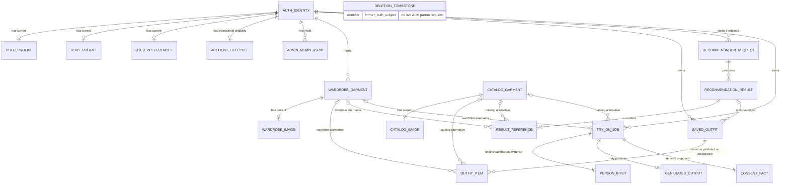

# Database Logical Relational Model v0.1 — Drape & Drop

November 6, 2026 · **Proposed logical model for review; not a deployed schema**

## Scope, evidence and status

This document converts the approved conceptual inventory into proposed relationships, identity rules, integrity requirements and deletion behavior. It defines no physical tables, column types, SQL, indexes, migrations or executable policies. Logical relation names below are labels, not database objects.

Inspected:

- [Entity inventory](entity-inventory.md), including the resumed review already present in the working tree.
- [35-contract API audit](../api-requirements.md) and [approved authentication/security architecture](../authentication-and-security.md).
- [Backend checkpoint](../checkpoint-001-security-foundation.md), [setup](../../../backend/README.md), [JWT verifier](../../../backend/app/security.py), [user-scoped adapter](../../../backend/app/data_api.py), [eligibility dependency](../../../backend/app/dependencies.py) and [app factory](../../../backend/app/main.py).
- [Frontend domain types](../../../mobile/src/types/domain.ts), [API resources](../../../mobile/src/services/api/resources.ts), [transport](../../../mobile/src/services/api/client.ts), [form schemas](../../../mobile/src/features/schema.ts), [outfit builder](../../../mobile/src/app/outfits/new.tsx), [outfit detail](../../../mobile/src/app/outfits/[id].tsx), [recommendations](../../../mobile/src/features/RecommendationsScreen.tsx), [try-on](../../../mobile/src/app/try-on.tsx) and shared editor behavior.

**Approved requirements:** Supabase Auth UUID identity; FastAPI business logic; user-JWT-scoped Data API access and RLS; no cross-user references; authenticated shared catalog; trusted administrator mutations; disabled/deleting account denial across FastAPI, direct Data API and Storage. Backend currently has security infrastructure only, with eligibility unconfigured and fail-closed.

**Recommendations below require approval:** separate-source references, dependency/deletion rules, bootstrap and unit semantics, and logical child records. **Unresolved:** physical grouping, actual lifecycle authority, retention periods, mixed-source API adaptation and Supabase implementation details. Recommendations are not newly approved decisions. No existing contract or frontend behavior changes in this document.

## 1. Entity relationship model

### Notation and common security rule

A cardinality describes permitted logical records, not whether a separate table is required. A mandatory child-to-parent link means every existing child has that parent; a parent may still have zero children. All user-owned links require equal verified ownership, an active owner, row visibility and restricted writes. Section 8 applies these rules to each relationship family.

### Relationship inventory

- **R01 — Auth identity → user profile:** 1:0..1 before bootstrap, recommended 1:1 for an application-ready user. Profile parent mandatory; owner is the Auth UUID. No shared boundary. Unique user/profile association and identity reference required; no client-controlled owner.
- **R02 — Auth identity → body profile:** 1:0..1, recommended one empty current body record after bootstrap. Parent mandatory if record exists; owner is the same UUID. No shared boundary. Measurements remain optional; identity uniqueness does not require body values to be populated.
- **R03 — Auth identity → preferences:** 1:0..1 before bootstrap, recommended 1:1 after bootstrap. Parent mandatory, same user owner, no shared boundary; uniqueness per identity. Separate logical responsibility from profile/body even if later physically consolidated.
- **R04 — Auth identity → account lifecycle:** one authoritative operational eligibility state per application-ready live Auth identity; an unbootstrapped identity may have none and must fail closed. Each operational state refers to exactly one live Auth identity. Trusted system owns state transitions; subject is the Auth UUID. Crosses user identity/trusted control boundary. Post-Auth-deletion tombstones are a distinct logical form of minimal trusted deletion evidence, not operational children requiring a live Auth parent. They may preserve the former subject identifier without a live-parent dependency. Whether operational state is transformed into that evidence or separate restricted persistence is used remains unresolved; its physical representation and retention are not decided here.
- **R05 — Auth identity → admin membership:** 1:0..N permission memberships if permission-based representation chosen; each membership requires one subject and trusted grant authority. Identity → catalog-admin membership is at most one current membership for that permission. Trusted control, not a user-owned editable child; no automatic permission from profile metadata. Representation remains proposed.
- **R06 — Auth identity → wardrobe garments:** 1:0..N; each garment has exactly one owner. Private boundary only. Stable garment identity and immutable owner association; future composite ownership references recommended.
- **R07 — wardrobe garment → current image association:** 1:0..1 for draft/incomplete records, if such records are persisted; every accepted garment must have exactly one valid current image association. Acceptance, not every intermediate record, requires the image. Draft persistence is not a newly approved API feature. Association parent mandatory; inherits private garment owner. No shared boundary. Object locator must resolve to that garment's authorized asset. Separate image entity versus parent fields unresolved.
- **R08 — catalog garment → current image association:** 1:0..1 for draft/incomplete records, if persisted; every accepted catalog garment must have exactly one valid current image association. Intermediate incomplete records need not already have an image; their persistence remains an implementation decision, not a new API feature. Association parent mandatory, shared authenticated data, administrator-managed. Storage association must target authorized catalog imagery, not another user's private asset.
- **R09 — Auth identity → saved outfits:** 1:0..N; each outfit has exactly one private owner. No shared boundary at header; unique stable outfit identity.
- **R10 — saved outfit → outfit items:** an outfit has item associations, each with one parent. Manual outfit creation currently requires at least two items at aggregate acceptance; the ER edge does not enforce that minimum. Recommendation-based save minimum cardinality remains unresolved until confirmed. Each item has exactly one outfit; owner inherits from outfit and must be consistent if repeated on child. No independent item transfer. Header/item creation must be atomic; exact cardinality for recommendation saves needs confirmation.
- **R11 — wardrobe garment → outfit items:** 1:0..N; each item has 0..1 wardrobe target, conditional on its source. Combined with R12, exactly one garment target is mandatory. Private target must have the outfit owner's identity; no cross-user garment reference even for an admin. Outfit ↔ wardrobe garment is M:N through items.
- **R12 — catalog garment → outfit items:** 1:0..N; each item has 0..1 catalog target, complementary to R11. Crosses private-outfit/shared-catalog boundary. Catalog must be an eligible shared read target; it does not transfer ownership of the outfit. Outfit ↔ catalog garment is M:N through items. This is a proposed capability needed to represent mixed results, not a contract modification.
- **R13 — Auth identity → recommendation requests:** 1:0..N if requests are persisted, each request owned by one user. Persistence duration and separate request relation unresolved; no API history is implied. Body/profile/wardrobe inputs are authorized data dependencies, not mandatory copies or permanent foreign keys.
- **R14 — recommendation request → results:** 1:0..N while the aggregate is retained, each result has one generating request if request persistence chosen. Same owner, no cross-user boundary. A request aggregate may hold results without separate physical records. Every returned result ID must resolve within its supported save window.
- **R15 — recommendation result → result garment references:** 1:N for a nonempty returned outfit. Each reference belongs to one result and follows the same exactly-one source and ownership rules as R11/R12. Count requirement is a product decision; do not infer two items for all generated results from the manual builder. Physical item relation versus protected aggregate remains unresolved.
- **R16 — recommendation result → saved outfit:** optional provenance; recommended result 1:0..N outfits until duplicate-save policy is approved. Outfit has 0..1 origin result; manual outfit has none. Both owners must match during save. Saved outfit has its own copied metadata/item associations, not ownership of the result's children; expiry must not invalidate the saved outfit. Optional provenance link may detach.
- **R17 — Auth identity → try-on jobs:** 1:0..N, every job has one private owner. Durable enough for a subsequent status request; no public job history endpoint is inferred.
- **R18 — wardrobe/catalog garment → try-on jobs:** each job chooses exactly one source-specific garment; each garment may have 0..N jobs. Private wardrobe reference must match job owner; catalog reference crosses the shared/private boundary and must be an eligible catalog target. Completed-job source deletion handling is proposed in Section 4.
- **R19 — try-on job → person input image:** every accepted job must have one valid authorized input association at submission; each input association belongs to one job in this proposal and inherits its owner. No cross-user or arbitrary object-path reuse. Later expiry/cleanup may remove the live object but must preserve minimal trusted evidence of valid submission while the job is retained. An expired/cleaned-up object is not an invalid original submission. Evidence may remain in the association or job; no physical representation, retention duration or expired-job API behavior is settled here.
- **R20 — try-on job → generated output image:** 1:0..1 for current response contract; output association has one job/owner. Only trusted processing may attach it. A completed readable result requires an available authorized image or explicitly reviewed expired-result semantics.
- **R21 — try-on job → consent evidence:** recommended one submission consent fact per accepted job, same subject/job owner. Trusted service records receipt, not arbitrary client-authored legal evidence. May be embedded in job, not a standalone relation. No consent-history API implied.
- **R22 — Storage object → image association:** durable object identity is bucket plus object locator, not signed URL. Recommend one active application ownership/purpose association for each uploaded object; cross-job or cross-domain asset sharing requires separate review. Private wardrobe/person/output assets and catalog assets must not inherit one another's access. Replacement objects can temporarily overlap only during controlled cleanup; no gallery feature is inferred.

### Proposed ER overview

The diagram shows selected logical relationships only. Request/result and asset/consent nodes may be embedded aggregates rather than separate tables. Lifecycle edges describe operational state for a live Auth identity only: zero before bootstrap, one required for an application-ready identity. The standalone DELETION_TOMBSTONE node represents possible post-deletion evidence with a former-subject identifier, deliberately without an Auth foreign-key edge; this is notation, not a proposed separate physical table. Image edges permit incomplete records without an image; acceptance requires exactly one valid current association. The outfit-item edge shows zero-or-many structurally without deciding recommendation-save minimums; manual acceptance separately requires at least two. PERSON_INPUT denotes retained submission association/evidence, not a guarantee that its Storage object remains live forever. Exactly-one garment alternatives, per-owner equality and lifecycle/grant rules cannot be expressed by ER cardinality alone; R11/R12/R18 and the text govern them. Physical separation and recommendations remain unapproved.

## 2. Identity and ownership

- Supabase Auth UUID is the root human identity. FastAPI verifies JWT subject; no editable profile name/email/role grants ownership. Do not duplicate passwords or refresh-token persistence into business entities.
- Profile/body/preferences use one current identity association; a separate internal ID is optional. Lifecycle uses an authoritative subject association that may require a deletion tombstone. Admin membership is keyed conceptually by subject plus granted permission, not client role.
- Wardrobe garments, catalog garments, saved outfits, recommendation results and try-on jobs require independent stable IDs because API calls/relationships reference them. A retained request needs an internal identity even though no request ID is currently returned.
- Outfit/result item associations need a unique parent/source/target identity; separate stable item IDs are optional since the current API does not address items individually. Preserve deterministic returned garment order if the presentation needs it; do not invent outfit editing APIs.
- Child ownership inherits from parent; repeated owner identity may support enforceable parent/target ownership constraints but must never be independently editable. Input/output/consent facts likewise inherit job ownership.
- Image identity is its durable authorized Storage association. Per-image surrogate IDs and standalone asset tables are physical choices, not required by imageUrl.
- Shared catalog is not user-owned wardrobe. Catalog may be referenced by private records but never exposes their owner or membership to ordinary catalog readers.
- Lifecycle, administrator grant/revoke and worker processing fields are trusted system data. A product admin has catalog authority only, not automatic access to every user's body profile, wardrobe or images.

## 3. Mixed-source outfit references

### Approach A — source type plus referenced ID

Concept: an item carries a source label and one target ID. It is concise and naturally matches try-on's existing `source` and `garmentId`. However, a bare polymorphic ID cannot normally be backed by one foreign-key relationship to either of two unrelated parents. Target existence, ownership and deletion handling need a trusted transactional resolver or additional integrity machinery; an owner-only RLS policy is insufficient. Queries branch/union by source. It still requires a reviewed API discriminator for mixed saved outfits; it does not repair wardrobe-only frontend links.

### Approach B — separate wardrobe/catalog references with exactly-one rule

Concept: item can reference a wardrobe target or catalog target, never both and never neither. Each target has an explicit referential relationship; wardrobe ownership is enforced with parent/target identity equality and suitable relational constraints. Shared catalog follows authenticated visibility. Unique parent/target associations prevent duplicate items; type-specific uniqueness must handle inactive alternatives correctly.

RLS can validate parent ownership and the chosen target without an arbitrary table resolver. Queries may need two optional joins or a normalized read projection; repetitive rules also apply to recommendation references and try-on selections. More reference fields are required internally, and adding a third source later requires review. It does **not** solve existing API ambiguity by itself.

### Approach C — unified garment reference model

Concept: one garment identity/registry relates to a private wardrobe subtype or shared catalog subtype, and items refer to that identity. A single parent relationship simplifies downstream joins and can preserve globally unique IDs. It introduces an extra central ownership/source boundary and requires enforcing exact subtype, immutable source, registry/subtype ownership consistency, grants and deletion behavior. RLS becomes more indirect; a shared row must never expose private subtype information. Migrating existing IDs or introducing registry IDs requires an approved compatibility design. A registry alone still cannot make `/wardrobe/:id` render a catalog piece correctly.

### Recommendation for approval

Recommend **B** for the two established sources: explicit references with an exactly-one invariant and owner-consistent wardrobe links, applied consistently to outfit items, recommendation references and job selections. It makes referential integrity visible without creating a new universal garment domain. A compact internal projection may derive source/ID for service use; no API is changed here.

**Compatibility blocker:** current Outfit returns `garmentIds` only; detail navigates every ID to `/wardrobe/:id`. Recommendation responses use the same type even when wardrobeOnly=false. Do not put catalog IDs into that array and claim compatibility. Review either a typed source-reference response plus corresponding navigation, or an explicitly approved conversion/snapshot workflow with meaningful new private identities. Automatic catalog copying is not approved and could alter what “my wardrobe” means. Manual creation can retain its existing wardrobe-only garmentIds input; saving by recommendationId must resolve result references on the server. Keep the 35-contract audit unchanged until an adaptation is separately approved.

## 4. Deletion and dependency behavior

All following behavior is **recommended for review**, not implemented. Physical deletion and ordinary UI deletion may need different internal stages, but no soft-delete/archive feature or new endpoint is presumed.

### Wardrobe garment

- **Restrict deletion** while referenced by a saved outfit or an active try-on job. This preserves valid links and prevents in-flight input loss. Current DELETE can surface 409, already recognized by transport, but the frontend lacks a contextual “remove from outfits” action; product approval is needed for the restriction UX.
- **Cascade deletion** of ephemeral recommendation item associations only as part of removing/invalidating the affected unsaved result aggregate, not leaving a result with dangling or silently missing items. Do not cascade into saved outfits.
- **Detach association / preserve minimal snapshot** for terminal try-on source references only if approved as described below; otherwise restrict until dependent jobs expire.
- **Asynchronous cleanup** of unreferenced garment image objects after logical deletion/commit; no database cascade is assumed to remove Storage bytes.

### Catalog garment

- Recommend **restrict deletion** while referenced by saved outfit items or active jobs; administrators cannot silently destroy another user's saved composition.
- Expire/remove affected unsaved recommendation results as an aggregate; **cascade** their own reference children, never saved looks.
- Terminal job source handling follows the same conditional detach/minimal-snapshot rule. Catalog image cleanup is **asynchronous** after references are cleared. Withdrawal/unpublication is a separate product choice, not a newly introduced field/API here.

### Saved outfit

- **Cascade deletion** of its own item associations; **detach** optional recommendation provenance.
- **Restrict any cascade into garments, catalog or recommendation history.** Outfit deletion preserves the user's actual wardrobe as the UI states.
- **Asynchronous cleanup** of exclusively owned outfit image assets if any exist. Asset reuse must be resolved before deletion so an image still needed by another retained object is not removed.

### Recommendation result (and retained request)

- On expiry/deletion, **cascade** only its result garment associations/temporary processing content; **detach** optional saved-outfit provenance.
- **Preserve snapshot:** at save time copy authorized result name/description/occasion and item associations into independent saved-outfit records. This is a business-metadata snapshot, not permission to copy third-party images or create wardrobe pieces. Saved records do not depend on the result's continued existence.
- Recommendation image references need independent ownership/retention or omission when saving; an expiring URL cannot become a durable saved asset. Exact policy unresolved.
- A retained request may **cascade** its results when its retention ends, after the above independence guarantees. Request payload may be minimized earlier if result saveability remains verifiable. No indefinite request history is required.

### Try-on job

- Accepted active job: **restrict deletion of its needed input/source** while processing. A trusted account-deletion orchestrator must quiesce work before cleanup; no cancellation/retry endpoint is proposed.
- Terminal job: propose bounded retention, then **cascade** job-owned associations/embedded facts when the job itself is removed and **asynchronously clean up** exclusively owned input/output objects. If input bytes expire before the retained job, preserve minimal trusted submission evidence and distinguish cleaned-up input from invalid submission. Evidence need not retain image bytes. Retention duration and the existing status endpoint's missing/expired behavior remain unresolved.
- For deletion of source garments after terminal processing, recommend **detach association with minimal provenance snapshot** sufficient to interpret the existing result, only if product retention permits it. This must not retain a deleted garment's private image or re-expose it. If snapshotting is not approved, retain a restriction until the job expires instead. An immutable job/result reference need not permanently block garment deletion.

### Image asset

- **Restrict deletion** of an object currently required by a live parent/job until replacement, approved expiry or parent deletion.
- Replacement: attach validated new object atomically at the record level, then **detach** old association and **asynchronously clean up** its unreferenced bytes. Failed writes need orphan cleanup; database and Storage are not one transaction.
- **Preserve snapshot/copy only with explicit retention and authorization approval**, never to evade user deletion. Signed URLs are transient delivery credentials; removing a row alone may not revoke already-issued access.

### User account

- Trusted lifecycle transition denies normal access first across FastAPI/direct Data API/Storage, even with an otherwise valid JWT.
- **Restrict/quiesce active processing** before removing referenced inputs; preserve only minimal trusted cleanup evidence necessary to finish and prove denial.
- **Cascade/delete** the user's outfit/result/item/job/profile/body/preferences associations in dependency-safe order; **detach** their permission memberships. Remove private garment references and assets; shared catalog garments survive because they are not owned by this account. Any administrator attribution reference must detach or retain only an approved minimal audit identity.
- **Asynchronous cleanup** coordinates Storage objects, generated results, processing providers and final Auth deletion. Do not assume relational cascades delete Auth users or Storage objects. Final completion/error semantics must remain compatible with DELETE /account; asynchronous public acceptance would need a separate contract review.
- A lifecycle deletion tombstone/cleanup record may temporarily **preserve** minimal security context after Auth identity removal. Its basis, duration and lack of normal-user access require approval; do not force a cascading Auth foreign key to erase the only active denial evidence.

## 5. Profile, preferences and bootstrap

Recommend separate **logical** profile, body and preferences responsibilities because sensitivity, field permissions and update semantics differ. Physical consolidation is permissible only if column/operation access can preserve those boundaries; a single row must not expose measurements through a public/shared projection.

Recommend idempotent bootstrap tied to verified identity: create exactly one profile/preferences and an empty body profile, with lifecycle eligibility established by trusted logic. Optional measurements/appearance remain unset. Users must not self-insert an “active” eligibility flag. Missing or incomplete bootstrap must fail closed for eligibility and must be recoverable without granting elevated client access. Choose trigger versus a narrow transactional bootstrap operation during physical design. Existing GET editors need a successful default representation; a permanent 404 blocks first-time editing. Do not fabricate completed profile data merely to avoid that error.

Administrator membership is **optional**, never part of ordinary default signup. The trusted membership source and grant/revoke process remain unresolved; an implementation may choose a permission relation or approved trusted claims, not user metadata.

### Measurement units — recommended responsibility split

Recommend body profile's unit describes the meaning of its stored measurement values; preferences.units is only the default entry/display preference. Updating preferences alone must never reinterpret existing numeric body measurements. Any body-unit change with existing values must preserve physical meaning by conversion or require an explicit complete replacement after review. Canonical internal unit versus retained entry unit, rounding, valid ranges and the effect of the frontend sending all values on PATCH remain unresolved. Neither field nor current UI behavior is changed here; review the adapter/UI conversion before claiming this is resolved in implementation.

## 6. Recommendation and try-on lifecycle

### Recommendations

Existing POST /recommendations returns completed `items`, not a request/job ID. Propose a short-lived owner-bound request/result aggregate for the result-save window; separate persisted requests are optional if an alternative retains sufficient owner/result evidence. Result references must remain validated, and each returned result ID must resolve to the requesting owner until expiry. Do not invent asynchronous recommendation status APIs or public history. Request preferences/body inputs should not be snapshotted indefinitely by default.

POST /outfits with recommendationId performs a single authorized save transaction: verify result owner/lifecycle/availability and current source permissions, create outfit header and independent item associations, and attach optional provenance. All succeed or none do. Expiry racing save must have a deterministic success/conflict rule. Duplicate-save uniqueness remains open. Saved outfits are durable until explicit user/account deletion and independent of temporary recommendation records.

### Try-on

POST /try-on provides one person file, selected garmentId/source and `photoConsent="true"`. Its accepted job needs durable owner/status/reference state so GET /try-on/:id can follow it. The client recognizes queued, processing, completed and failed. Recommend trusted transitions queued → processing → completed or failed, allowing failure during validation/dispatch without claiming an expanded state contract. User writes must not set status/output. No cancellation, retry or history feature is added.

Every accepted job must have a valid input association at submission. Person input is temporary sensitive processing data, not a permanent body-profile photo. Later object cleanup must not erase minimal trusted evidence that the retained job was validly submitted; record expired/cleaned-up availability distinctly from an invalid submission without adding a new API status by implication. Generated output may last for an approved result window; current API has no “save result” action. Submission consent should be recorded with job/subject association, potentially as embedded evidence rather than another table. Policy version/timestamp/withdrawal requirements need review because the current body sends only true; recording a boolean is not proof of legal compliance.

Workers use explicitly scoped trusted job operations, never stored user refresh tokens or blanket personal-data access. Recheck account lifecycle before reading inputs and attaching outputs. Persist object associations, not arbitrary client URLs; do not infer an image gallery or model-training dataset. Physical cleanup and job completion must not race into recreating deleted-account outputs.

## 7. Conceptual integrity constraints

- **Identity and uniqueness:** unique server resource identities; one current profile/body/preferences/lifecycle subject mapping; one current membership per chosen permission. Enforce with identity relationships and uniqueness, not frontend checks.
- **Parent/child ownership:** each outfit/result/job child must match parent owner. A composite owner-and-resource foreign-key design is recommended where suitable, with owner immutable. Enforce each target as well as parent; RLS visibility of the parent alone is insufficient.
- **Source validity:** exactly one wardrobe/catalog reference per relevant item/job. Checks enforce alternative selection; separate foreign keys enforce target existence. Owner-consistent wardrobe constraints plus transactional checks enforce private access; catalogue target permission/current availability needs a service/database rule.
- **Unique outfit membership:** unique outfit/wardrobe target and outfit/catalog target associations; reject repeated identical source/target unless later required. Same-source uniqueness does not accidentally collide a wardrobe and catalog ID. Membership-count rules require transaction/aggregate validation; a foreign key cannot enforce “at least two.”
- **Recommendation saves:** verify subject/result equality, unexpired result, current target access and lifecycle, then atomically copy. Optional provenance cannot enforce a mandatory lifetime dependency. Resolve expiration and duplicate-save races transactionally.
- **Try-on inputs:** one valid selected target, authorized person object/input association, matching job owner and recorded required consent at submission; no attaching another user's input/output. Preserve minimal valid-submission evidence for a retained job after input-object cleanup, without requiring retention of the personal image itself. Trusted operations control processing fields and validate file associations.
- **Storage association:** distinguish current attachment from pending upload/cleanup. Only one active association per intended object/purpose unless sharing is separately approved. Database references must not claim nonexistent/unauthorized Storage content; cross-service validity requires trusted orchestration, not a conceptual database FK to bytes.
- **Protected controls:** users cannot create/reactivate lifecycle state, grant membership, change ownership or forge results. Column/operation grants, checks and trusted transitions complement RLS. Client-supplied role or owner values never become authoritative.
- **Deletion:** ordinary deletes follow Section 4. Cleanup can require a minimal restricted state record; no exact schema or audit store is decided. Database referential rules, trusted transactions and cross-service cleanup each have distinct responsibilities.

## 8. Security and RLS implications by relationship family

No policies are implemented by this model. Apply the approved JWT context and least-privilege schema/table/operation/column/function privileges to all exposed paths. Disabled/deleting accounts are denied normal operations even if JWT verification succeeds; Data API and Storage paths must enforce this independently of FastAPI. Previously signed URLs/downloaded images remain an explicitly unresolved delivery boundary.

- **R01–R03 personal singletons:** only verified subject reads/updates their row; sensitive body fields cannot leak through joined profile/settings projections. Direct writes cannot set another identity, broaden permissions or create unlimited duplicate singleton records. Bootstrap grants do not include lifecycle/admin writes.
- **R04 lifecycle:** trusted-only mutations; normal users cannot self-enable. Authoritative checks must remain available without exposing other users' state or recursively depending on already-denied private rows. A deleted Auth subject's unexpired JWT must still fail eligibility.
- **R05 membership:** trusted-only grant/revoke, minimum permission projection if needed; no ordinary direct table mutation. Trusted admin membership is checked alongside active lifecycle, not instead of it.
- **R06–R07 wardrobe/images:** owner-only reads/writes, valid owner/purpose object association. An owner cannot attach another subject's object path through a direct PATCH. Deleting parent does not imply deletion privilege over unrelated objects.
- **R08 catalog/images:** active authenticated readers may read eligible shared content; only trusted active admins mutate. Private storage cannot be laundered into a catalog image association. Shared SELECT does not expose referencing private outfits/results/jobs.
- **R09–R12 outfit/items:** require owner equality for outfit/child/private target and immutable ownership. Shared target checks are catalog visibility, not catalog ownership by outfit owner. Direct inserts/updates/deletes cannot bypass exactly-one references, parent/target validation or aggregate save rules; constrain base writes or use approved invoker operations.
- **R13–R16 recommendation aggregate/provenance:** private to requesting owner; generated fields controlled by processing service. Direct save by foreign recommendation ID must fail. Snapshot independence does not preserve access to a later-deleted user's data, and optional provenance must not expose another account's result.
- **R17–R21 jobs/images/consent:** private owner visibility; user may submit only allowed fields through validated operation. Deny direct user status/result/owner fabrication. Processing privileges are isolated; worker and object associations maintain owner/purpose checks and stop on disabled/deleting eligibility. Consent subject must agree with job owner.
- **R22 Storage links:** private buckets/purpose-aware object access, shared catalog access separately authorized. Application identity checks and Storage authorization must agree. Normal user access never silently falls back to service-role credentials. Any narrowly privileged cleanup has its own scope/evidence.

Test every family through direct Data API attempts as well as FastAPI: user A/user B swaps, ownership updates, wrong target source, fabricated object paths, lifecycle denial and privilege escalation. Real database identity and Storage denial have not yet been tested by the existing backend unit suite.

## 9. API compatibility review

The [35-contract inventory](../api-requirements.md) remains unchanged. Below covers every numbered API without introducing routes or changing payloads.

- **01–07 auth/login/signup/reset/reset-confirm/password/logout/me:** Supabase-managed identity/session responsibilities; no application password/refresh-token relations. Custom frontend auth calls require their explicit approved migration. GET /auth/me remains declared-only; this model does not activate it.
- **08 DELETE /account:** lifecycle state and dependent owned records/assets/Auth orchestration. Current success implies completion; public asynchronous acceptance cannot be silently substituted.
- **09 GET /dashboard:** derive owned garment/outfit/recommendation counts. No dashboard statistics table justified; recommendationCount's exact definition remains open.
- **10–11 GET/PATCH /profile:** profile singleton; bootstrap/default read, full form clearing and owner-safe update semantics need mapping.
- **12–13 GET/PATCH /profile/body:** body/appearance singleton. Appearance fields are present in forms but absent from BodyProfile type; nullable numeric input and units need explicit reconciliation before physical constraints.
- **14–15 GET/PATCH /settings:** preference singleton; preference units versus body meaning as Section 5; string email preference values preserved.
- **16 GET /wardrobe; 20 POST /wardrobe; 21–23 GET/PATCH/DELETE /wardrobe/:id:** wardrobe/image associations; multipart creation/replacement mapping retained. Proposed referenced-garment restriction may return existing 409 but requires UX review, not silently fabricated success.
- **17 GET /catalog; 28 GET /catalog/:id; 19 GET /admin/catalog; 24 POST /admin/catalog; 25–27 GET/PATCH/DELETE /admin/catalog/:id:** one shared catalog domain and image association, not a separate private admin catalog. Detailed admin review deferred. Catalog-dependent deletion/restriction needs approval.
- **18 GET /outfits; 29 POST /outfits; 30–32 GET/PATCH/DELETE /outfits/:id:** outfit/items and optional detached provenance. Manual wardrobe-only garmentIds can map unchanged; mixed-source results cannot be encoded safely by source-less IDs plus wardrobe-only links. Future response/reference/navigation adaptation requires explicit approval. Metadata PATCH remains metadata only.
- **33 POST /recommendations:** owner-bound temporary request/result aggregate; synchronous Page<Outfit> retained as audited. Server-saveable result ID and expiry rules need decision. No new request-status contract is introduced.
- **34 POST /try-on; 35 GET /try-on/:id:** selected target plus input/consent and job/output associations; source string is already explicit here. Expired object/job states are not in the current four-value processing enum; choose missing/expired handling without silently adding states.

Other integration constraints: imageUrl is a transient response field, not a canonical object reference. Saved outfit/recommendation image ownership and independent retention remain unresolved; no outfit image upload endpoint exists. New profile GET must not permanently return 404/204 if the editor is expected to initialize. PATCH currently sends full fields with blank strings/null numbers, so sparse-update assumptions would lose intended semantics. None of these issues changes current code or contracts in this task.

## 10. Open decisions before physical schema design

### Recommended for approval

1. Explicit separate wardrobe/catalog references with exactly-one rule and per-owner private target consistency (Approach B).
2. Independent saved outfit metadata/items; detachable recommendation provenance so retention expiry does not invalidate saves.
3. Restrict ordinary garment deletion while saved outfits/active jobs reference it; retain no silent dangling references.
4. Separate logical profile/body/preferences with idempotent identity bootstrap; body units describe measurements and preferences units describe presentation/defaults.
5. Owner- and purpose-bound image associations, minimal job consent fact, trusted processing fields and least-privilege direct API operations.

### Requiring product input

1. Mixed-source API adaptation versus explicit private conversion; whether catalog copies mean wardrobe ownership. No option is silently selected for frontend behavior.
2. Garment deletion restriction UX, removing dependencies, catalog withdrawal and terminal-job provenance snapshots versus waiting for expiry.
3. Recommendation save-window/duplicate-save behavior and dashboard count meaning; request/result retention and image snapshot permissions.
4. Person input/output retention, completed-result expiry UX, consent policy/version/withdrawal and account deletion completion expectations.
5. Singleton defaults, optional profile values, measurement conversions/ranges/rounding and preference changes.

### Dependent on Supabase/physical implementation review

1. Authoritative account eligibility and tombstone lifetime after Auth deletion; no automatic cascade that destroys denial evidence too soon.
2. Trusted administrator membership representation/provisioning and permission helpers; admin workflow approval still deferred.
3. Exact ownership foreign keys, check/unique enforcement and transaction boundaries for multi-row writes and direct Data API paths.
4. Asset records versus parent fields, Storage path/purpose enforcement, upload/database partial failures and cleanup authorization.
5. Signed URL lifetime/renewal/revocation limitations and all-path disabled/deleting enforcement.
6. Exposed schemas/grants/RLS/invoker operation boundaries and actual user-A/user-B/admin test setup. No schema or RLS acceptance is claimed by transport-only tests.

### Proposed next milestone

Review the recommendations and resolve the blockers above. Then prepare a physical-schema design specification and permission/integrity test matrix, still subject to approval before executable migrations. Define constraint/deletion actions and Storage lifecycle together; only afterward implement development migrations/policies and prove identity isolation with actual Supabase tests. This document does not authorize new product features or settle unresolved architecture by implication.
