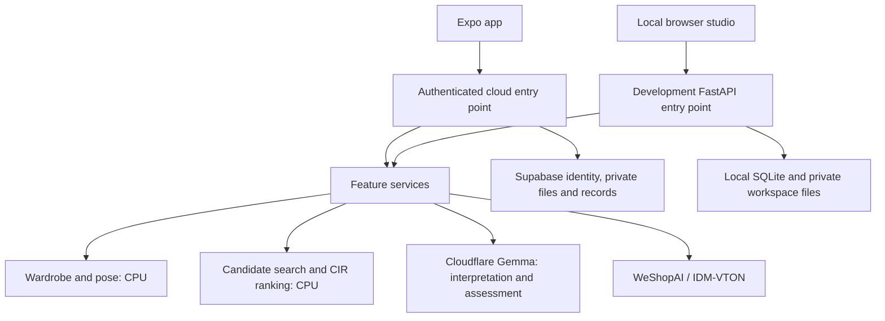

# Architecture

The application composes pretrained components. The backend performs CPU image
analysis and ranking; provider services perform language/vision assessment and
try-on generation. The phone captures/uploads images and displays results.

## Wardrobe upload

Validate/rotate the image, reject unusable clothing input, remove background,
classify category/attributes, extract colours and check duplicate evidence.
Store the item and embedding. User corrections update metadata. CPU preparation
and tagging are in `app/wardrobe`; persistence is kept in `app/persistence`.

## Body analysis

Validate one standing front-facing full-body person, run CPU MediaPipe, calibrate
visible dimensions to entered height and return unconfirmed estimates. The user
reviews/edits/confirms before saving to their profile. Front waist width is not
circumference. Body analysis and try-on have independent photo selections.

## Recommendation request

Load the owned wardrobe and structured conversation state. Interpret the request,
preserve explicit garment/occasion constraints, construct/retrieve candidates and
rank them. Preferences and feedback affect shortlisting. Send actual shortlisted
garments and contextual facts to the configured visual stylist. Return assessed,
distinct main outfits and persist follow-up state. Ranking scores are not
calibrated suitability probabilities. Quality remains under evaluation.

## Try-on request

Validate one selected garment/person image, create a private job, prepare garment
references on CPU and submit to WeShopAI. If generation fails for one top, try
IDM-VTON and record the actual provider/attempts. IDM can also be chosen directly.
No active path loads the archived FASHN VTON generator. The CPU human parser is
a separate garment-isolation dependency. Numeric photo estimates do not control
the hosted generator's physical sizing.

## Deployment boundary

The local combined server is a development tool with legacy upload/media routes.
The mobile deployment uses verified Supabase identities, private storage and the
cloud adapter. Gradio mobile transport and FastAPI routes are different contracts;
do not mix endpoint paths between them. Queue isolation, durable recovery and
authenticated hosted/phone tests remain deployment work.

## Compatibility and storage

Source packages now use feature names. Existing `/phase3/*` endpoints, `PHASE3_*`
environment variables, session fields and `storage/phase3_*` assets are preserved
to avoid breaking saved data and clients. These names are compatibility details,
not instructions to add new phase-based packages. Research and archived source
are not imported by the runtime.
